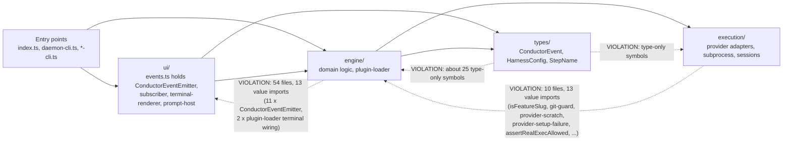
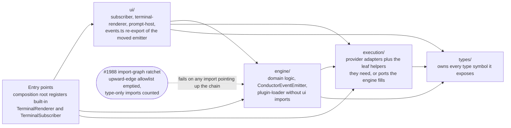
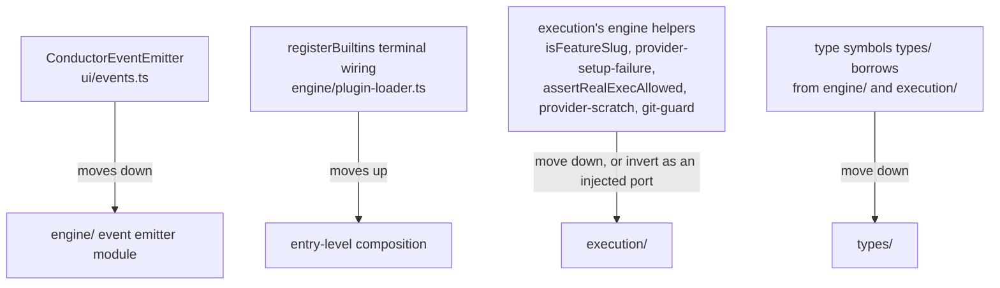

# Components: Enforce the documented source layer directions (#1017)

**Last updated:** 2026-10-12
**Scope:** Import directions between the five layers of `src/conductor/src/` and the entry-point files,
and the relocations that make the documented one-way chain `types ← execution ← engine ← ui ← entry points`
true. Plan stem: `break-the-engine-ui-import-cycle-and-stop-types-im`.

## Diagram

### Current state — upward edges that violate the chain

### Target state — enforced one-way chain

### Relocation map

## Legend

- Solid arrow: a permitted import, pointing from the importer to the imported layer. Every layer may
  import any layer below it in the chain.
- Dotted arrow labelled VIOLATION: an existing import that points up the chain. Counts were measured by
  import grep on 2026-10-12.
- `ui/events.ts` keeps re-exporting the moved emitter, which is a permitted `ui → engine` edge, so about
  400 test importers stay unchanged.
- An `execution/` helper that pulls in substantial engine code, such as `engine/git-guard.ts` via
  `git-hook-assets.ts`, is inverted instead of moved: `execution/` declares the port and the engine
  supplies the implementation. The ADR records this per-edge rule.
- `tools/` is omitted. It keeps its current permitted edges to `engine/` and `types/`.

## Change Log

| Date | Change | Reason |
|------|--------|--------|
| 2026-10-12 | Initial generation | Spec for #1017: break the engine/ui cycle and enforce layer directions |
| 2026-10-12 | Plan update: the plan places terminal composition in entry-level `terminal-builtins.ts`/`cli-builtins.ts`, inverts git-guard as the required `DispatchGitGuard` port, and keeps provider ids opaque (`ProviderId`) in `types/`; diagrams unchanged in structure | /plan step 8b |
| 2026-10-12 | Enforcement node now names the #1988 ratchet | Conflict-check: reuse adr-2026-10-07 D5 instead of a second checker |
