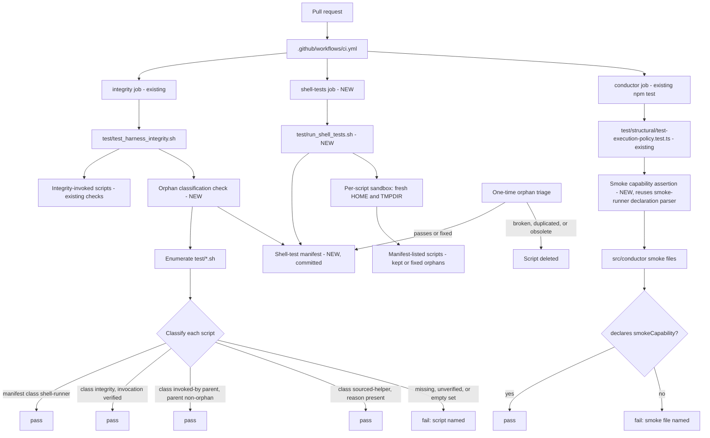

# Components: Shell-test execution and orphan guard

**Last updated:** 2026-10-10
**Scope:** How every `test/*.sh` script reaches execution in CI. A committed manifest feeds a
sandboxed runner in a new CI job. A new integrity check classifies every script and refuses
orphans. A Vitest structural test asserts that every smoke file declares a `smokeCapability`. Existing
integrity-invoked scripts and the existing default-suite smoke exclusion are unchanged.

## Diagram

## Legend

- **NEW** marks a component this feature adds; unmarked nodes already exist on `main`.
- **Manifest** is the single committed list of scripts the runner executes. The guard reads the
  same list, so the two cannot disagree.
- **Sandbox** means each script runs with a run-scoped `HOME` and `TMPDIR` that the runner creates
  and removes, so installer tests cannot write operator state.
- **Classes** are declared per script in the manifest: `shell-runner`, `integrity`,
  `invoked-by:«script»`, or `sourced-helper`. Every class other than `shell-runner` carries a
  written reason, and the guard verifies each declaration rather than inferring it.
- **Triage** is the one-time disposition of the ~37 current orphans. It is not runtime behavior.

## Change Log

| Date | Change | Reason |
|------|--------|--------|
| 2026-10-10 | Initial generation | Intake #1021 — bash tests never executed |
| 2026-10-10 | Classification declared in the manifest, replacing a separate exemption list | Architecture review condition C1 |
| 2026-10-10 | Smoke capability assertion moved from integrity to the Vitest structural test | Architecture review: reuse the one declaration parser |
