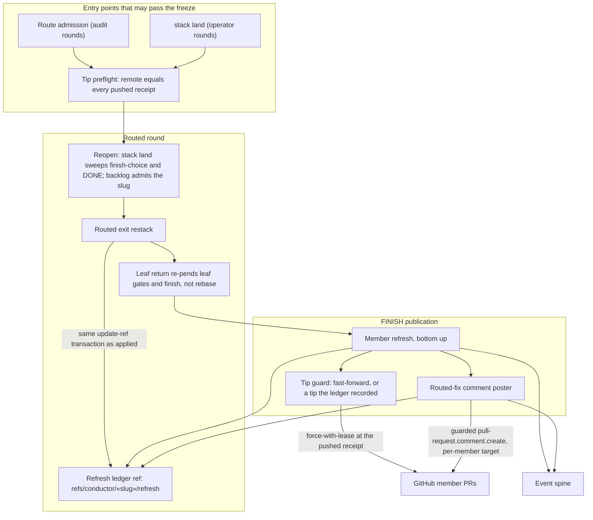
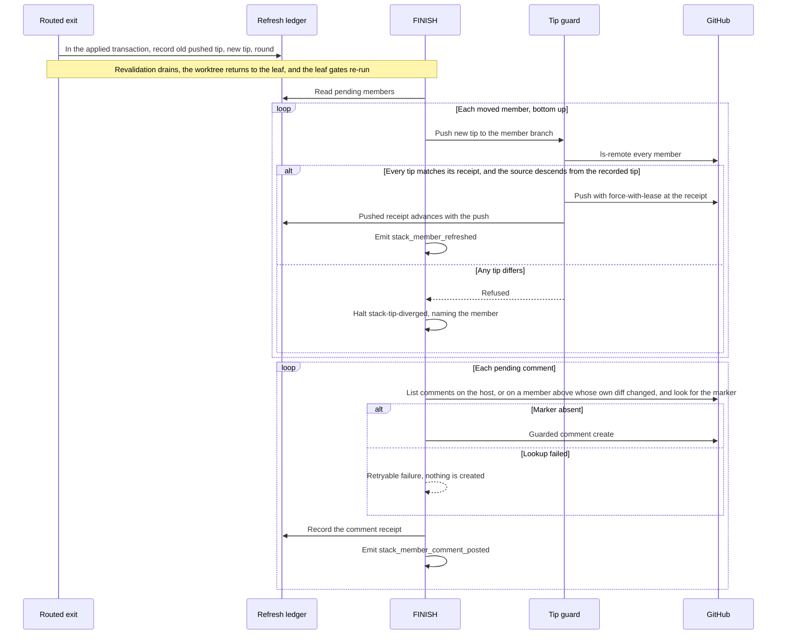

# Sequence + Components: Refresh a published stack after a routed fix (#3269)

**Last updated:** 2026-11-01
**Scope:** The first post-publication engine write path. A routed round may now run on a published
stack. The restack records each member it moves, and FINISH refreshes those members on GitHub after
the leaf gates pass, then posts one comment per routed fix on the host and on any member above it whose own diff changed. Governing decision: `adr-2026-11-01-routed-fix-refreshes-a-published-stack`. These
diagrams show only what this spec builds. Routed repair itself is drawn in
[`whole-feature-audit-fixes-cannot-land-in-the-stack.md`](whole-feature-audit-fixes-cannot-land-in-the-stack.md).

## Diagram: components

## Diagram: sequence

## Legend

- **Refresh ledger:** a durable ref holding, per member, the tip last pushed, the tip the restack recorded, and the rounds still owed a comment. A member above the host is owed one only when its patch id differs.
- **Tip guard:** `stack-tip-guard.ts`. Everything outside this path stays fast-forward only.
- **«slug»:** the feature slug.

## Change Log

| Date | Change | Reason |
|------|--------|--------|
| 2026-11-01 | Initial generation | #3269 first post-publication write path |
