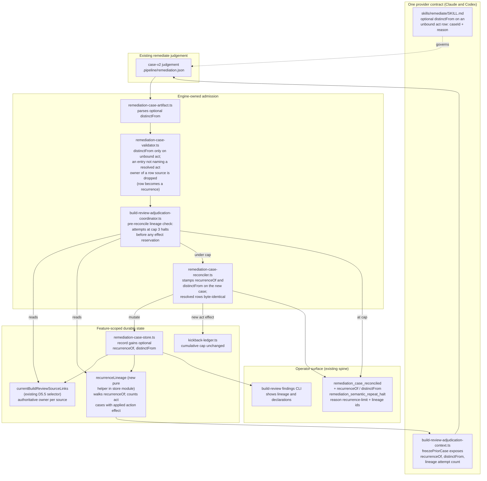

# Components: recurrence lineage for build_review act cases at a resolved anchor

**Last updated:** 2026-10-23
**Scope:** Proposed component boundaries for jstoup111/ai-conductor#3124. An unbound `act`
proposal whose source's authoritative link (D5.5) belongs to a resolved `act` case is still admitted
as a new case. The engine records that new case as a recurrence of the resolved case unless the
judge declares it distinct, with a reason. A lineage shares one BUILD attempt count with a cap of 3.
Only an exhausted lineage halts. Non-`act` dispositions, decision stops, and explicit rebinds are
unchanged.

## Diagram

## Legend

- **Contract**: the single remediate skill and frozen context that every provider renders. A
  `distinctFrom` declaration is the judge's explicit, reasoned statement. The engine never infers it
  from prose.
- **Admit**: the existing parse, validate, coordinate and reconcile seams. Only their admission
  rules change.
- **State**: `recurrenceOf` and `distinctFrom` are optional, engine-stamped fields on a new case
  only. Lineage attempts count durable `applied` action effects, not lap-local work-order evidence.
- **Operator**: additive fields on existing `ConductorEvent` members. No new channel or sidecar.

## Change Log

| Date | Change | Reason |
|------|--------|--------|
| 2026-10-23 | Initial component diagram | #3124 recurrence lineage |
