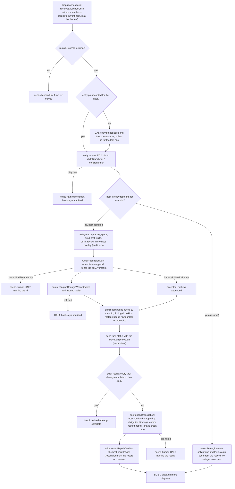
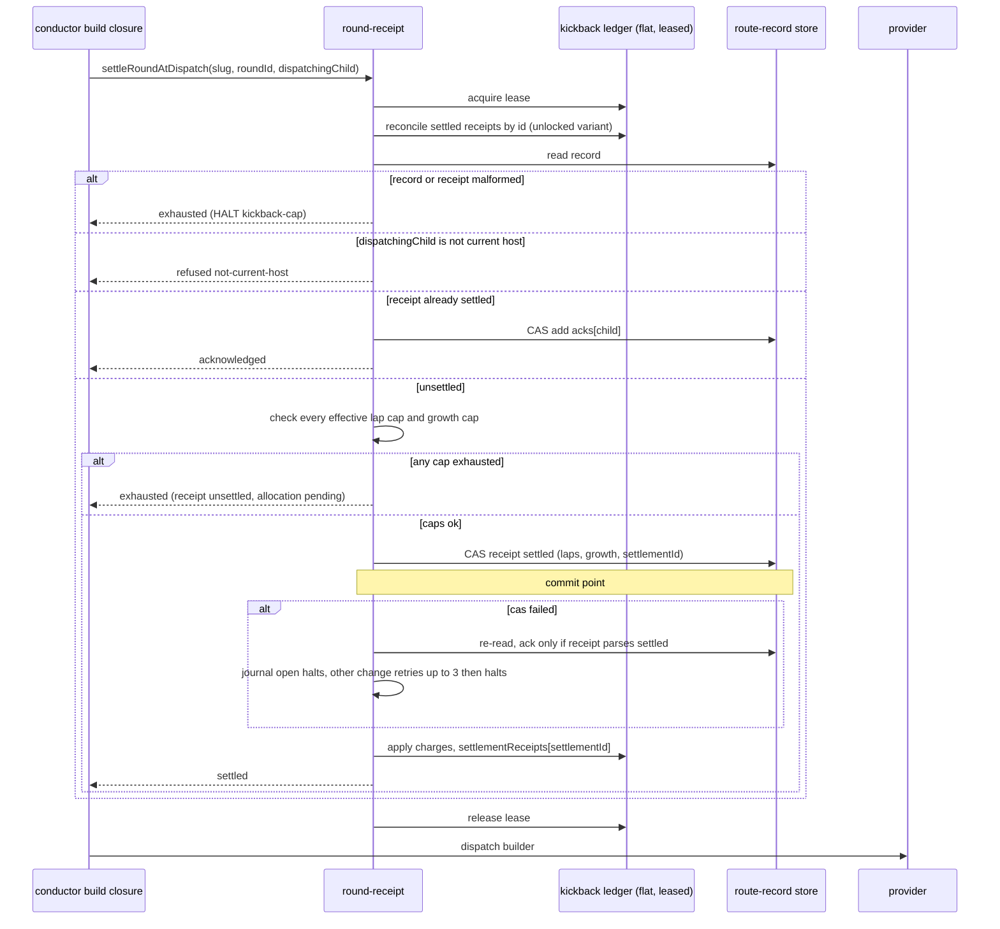
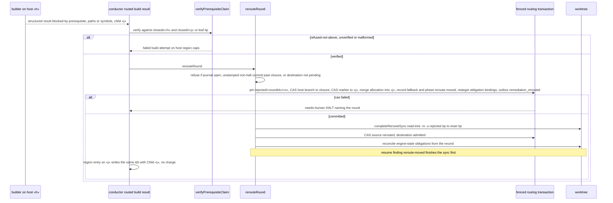
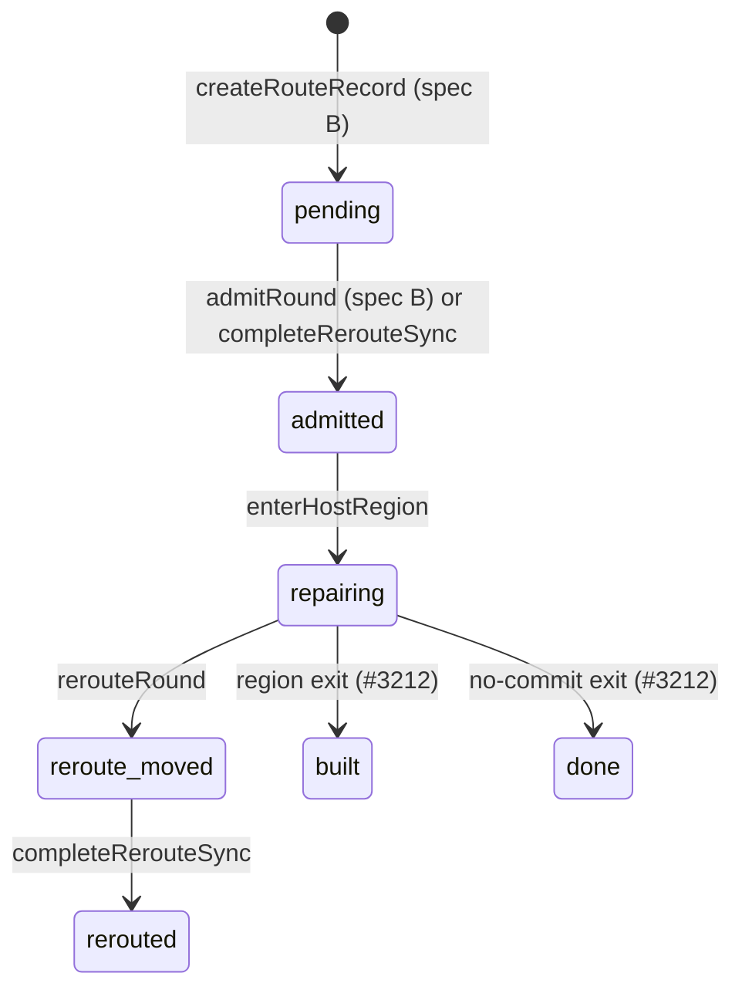
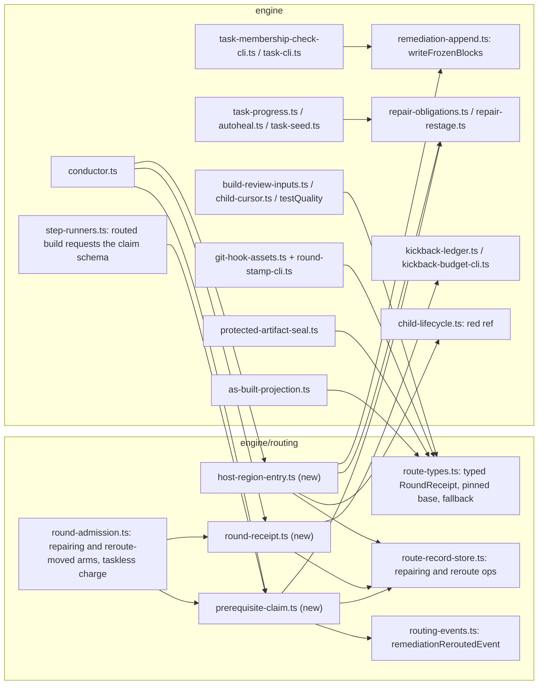

# Sequence + Components: Build, charge and review a routed fix on the child that hosts it (#3211)

**Last updated:** 2026-10-15
**Scope:** Spec C of the four-spec split of `adr-2026-10-12-routed-whole-feature-repair`
(decision 18). It covers the routed-repair pass: entering the host's region, writing the frozen
rem blocks on the host's branch, charging the round once, binding repair obligations to the host's
branch, grading the repair against a pinned base under a per-round credit, and moving the round
upward only on a verified builder claim. The whole design is drawn in
[`whole-feature-audit-fixes-cannot-land-in-the-stack.md`](whole-feature-audit-fixes-cannot-land-in-the-stack.md),
and admission (spec B) in
[`admitted-whole-feature-fixes-in-a-stacked-feature-.md`](admitted-whole-feature-fixes-in-a-stacked-feature-.md).
These diagrams show only what this spec builds.

Covered (ADR decisions 5 and 9–12, plus the items spec B moved here):
- host region entry once per `(roundId, host)` for the round's current host: the entry pin, the switch, the `audit` restage, the verbatim frozen-block write and `admitted`→`repairing`;
- `Round:` stamping, membership from the `Child:` line, seal rotation over frozen ids, `closeChild`'s `red/c«k»` ref and verify-green acceptance in a routed pass;
- the typed round receipt settled at the first host's BUILD dispatch, taskless admission charging, the stored growth denominator, ledger reconciliation and rebuild;
- repair obligations keyed by round and bound to a branch;
- the `routed-repair` review base shared with testQuality, and `routedRepairCredit`;
- the verified prerequisite reroute, `reroute-moved` recovery and `remediation_rerouted`.

Built on spec B (#3243): `writeRoutingTransaction`, `createRouteRecord`, `transitionHost`,
`admitRound`, `reconcileRounds`, `allocateFrozenBlocks`, `selectHost`, `resolveExecutionChild` and
`routedRepairPhaseEvent`.

Out of scope, delivered by #3212: the `revalidate` round kind's restage arm, its verify-green pass
and its review bases; host exit (`built`, `done`), the no-commit exit and marker deletion; the
exit restack, the re-validation queue, host progression (`selectNextHost`) and the leaf return. After this spec a host builds in
`repairing` and stops there, which is unreachable while the routing setting stays off.

With the setting off, or when the cursor reports `no-child`, every path below collapses to today's
leaf remediation, byte for byte.

## Diagram: host region entry

## Diagram: settlement at BUILD dispatch

## Diagram: verified prerequisite reroute

## Diagram: host phases written by this spec

## Diagram: components touched

## Legend

- **host «h» / child «j»**: a closed child of the stack at position h or j; the leaf is the last host.
- **closure**: `refs/conductor/«slug»/closed/c«k»`, written by `closeChild`.
- **fenced routing transaction**: `writeRoutingTransaction`, one `update-ref --stdin` carrying a
  `verify` of the restack journal ref.
- **frozen allocation**: per-host rem ids and complete block bodies stored in the route record at
  admission (spec B). This spec only writes them, verbatim.
- Diamond outcomes ending in HALT write a needs-human halt unless labelled `kickback-cap`.

## Change Log

| Date | Change | Reason |
|------|--------|--------|
| 2026-10-15 | Initial generation | Spec C DECIDE (#3211) |
| 2026-10-15 | Entry pin first, seed before repairing, resume verifies branch and reconciles obligations, settlement always reconciles under the lease, reroute merges into a pending destination; selectNextHost moved to #3212 | Codex review folded into the architecture review (F9–F17) |
| 2026-10-15 | Plan update: `writeFrozenBlocks` lives in `remediation-append.ts`; the routed build's structured claim is requested from `step-runners.ts`; custom-step kickbacks keep the ledger bump with a receipt echo | `/plan` (32 tasks) |
