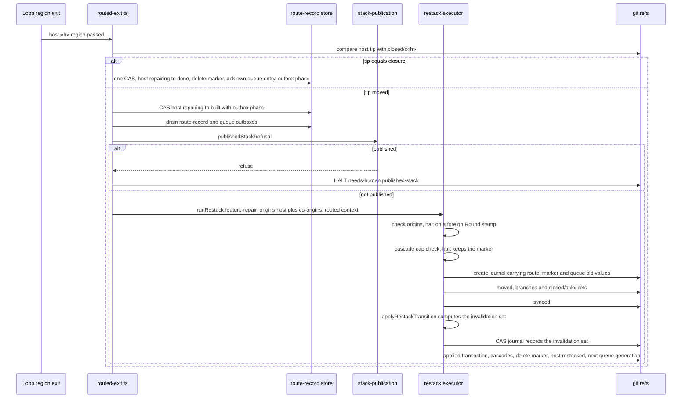
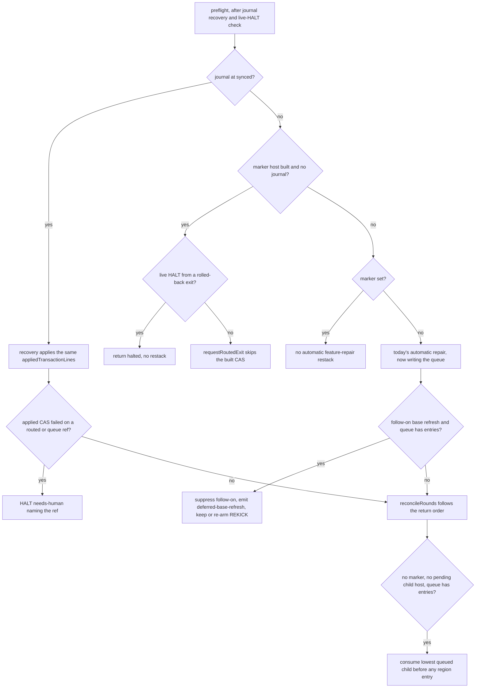
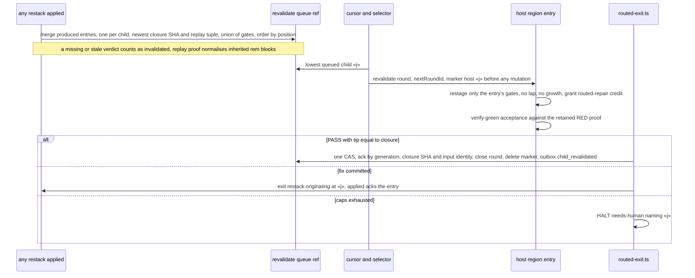
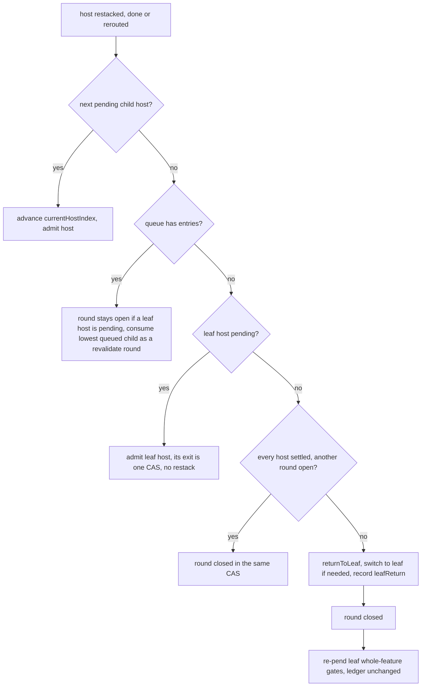
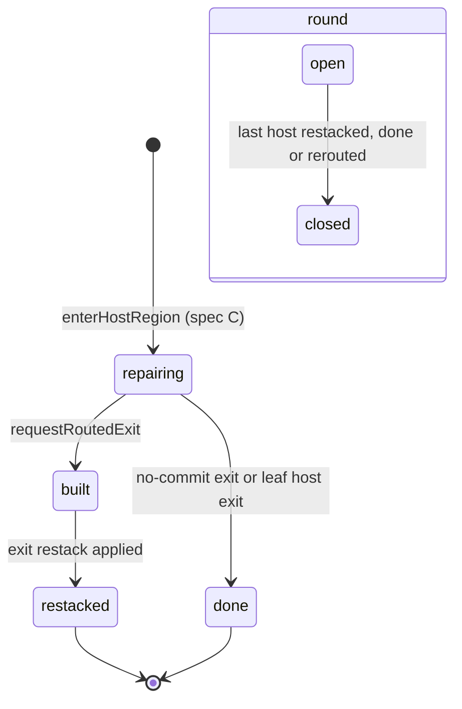
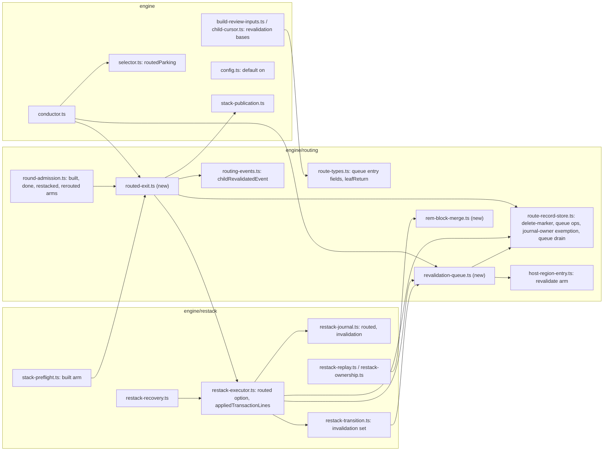

# Sequence + Components: Carry a routed fix up the stack and re-validate the children above (#3212)

**Last updated:** 2026-10-23
**Scope:** Spec D, the last of the four specs `adr-2026-10-12-routed-whole-feature-repair` is split
into (decision 18). It covers how a routed repair ends:
- the host leaves through one journaled exit restack, or through a no-commit compare-and-swap;
- the round moves on to the next host;
- every closed child a restack moved is re-validated, bottom-up, through a durable queue;
- the worktree returns to the leaf, and the leaf's whole-feature gates re-run.

It then turns `stacked_prs.route_whole_feature_fixes` on by default.

The whole design is drawn in
[`whole-feature-audit-fixes-cannot-land-in-the-stack.md`](whole-feature-audit-fixes-cannot-land-in-the-stack.md).
Admission (spec B) is in
[`admitted-whole-feature-fixes-in-a-stacked-feature-.md`](admitted-whole-feature-fixes-in-a-stacked-feature-.md),
and the routed-repair pass (spec C) in
[`a-routed-fix-cannot-be-built-charged-and-reviewed-.md`](a-routed-fix-cannot-be-built-charged-and-reviewed-.md).
These diagrams show only what this spec builds.

Covered:
- **Decision 13:**
  - the exit restack with routed lines in the `applied` transaction;
  - the restack's own exemption from the route-record writer fence;
  - marker deletion;
  - co-origins;
  - the cascade-cap halt that keeps the marker;
  - the preflight's `built` arm;
  - `hostNoOpEvidence` and the no-commit exit;
  - host progression;
  - the published-stack refusal.
- **Decision 9:** the replay union of appended rem blocks.
- **Decision 14:**
  - queue production on every restack cause, including recovery;
  - the gate-input-identity skip;
  - bottom-up `revalidate` rounds with their restage arm, verify-green pass, review bases and credit;
  - acknowledgement and its guards;
  - failure handled through the child's own exit.
- **Decision 15:** leaf parking, the recorded leaf return, and leaf gates re-pended under their existing caps.
- **Decision 16:** the queue outbox and its drain.

**Built on shipped code:**
- **The route-record store and its writer:**
  - `writeRoutingTransaction`
  - `transitionHost`
  - `drainOutbox` and `drainRoutingOutboxes`
  - `nextRoundId`
- **Reconciliation and region entry:**
  - `reconcileRounds`
  - `enterHostRegion` and the host `entry` baseline
- **The queue's existing pieces:**
  - the `revalidate` ref
  - `RevalidationQueueRecord`
  - the `child_revalidated` event
- **Cursor and execution child:**
  - the cursor's `revalidating` and `coOrigins` fields
  - `resolveExecutionChild`
- **Restack and publication:**
  - the restack executor, recovery and the preflight
  - `publishedStackRefusal`

**Not covered:** the PR comment on a published child, and refreshing a published stack. Both stay
with #3269 and #3268. The publication ADR (decision 11) freezes a published stack, so every routed
path here refuses on it.

With the setting off, or when the cursor reports `no-child`, every path below reduces to today's
leaf remediation, byte for byte.

## Diagram: routed exit restack

## Diagram: crash recovery on the exit path

## Diagram: re-validation queue

## Diagram: return order after a host settles

## Diagram: host and round phases written by this spec

## Diagram: components touched

## Legend

- **host «h» / child «j»**: a closed child of the stack at position h or j. The leaf is the last host.
- **closure**: `refs/conductor/«slug»/closed/c«k»`.
- **queue**: `refs/conductor/«slug»/revalidate`, a blob holding the generation, the entries and an
  outbox.
- **appliedTransactionLines**: the single builder of the restack's `applied` `update-ref --stdin`
  lines. The normal path, base refresh and recovery's `synced`→`applied` all use it.
- **journal-owner exemption**: the route-record fence lets the restack whose journal is open write
  routing refs. Every other writer is still refused.
- HALT outcomes are needs-human unless labelled otherwise.

## Change Log

| Date | Change | Reason |
|------|--------|--------|
| 2026-10-23 | Initial generation | Spec D DECIDE (#3212), re-derived from current code |
| 2026-10-23 | Return order keeps an audit round open until its leaf host settles; queue merge unions gates; standalone queue consumption and follow-on base-refresh deferral in recovery | Codex review folded into the architecture review (C8, C4, C12, C13) |
| 2026-10-23 | Recovery re-arms REKICK when it defers a follow-on base refresh | Operator decision at /plan (C13) |
