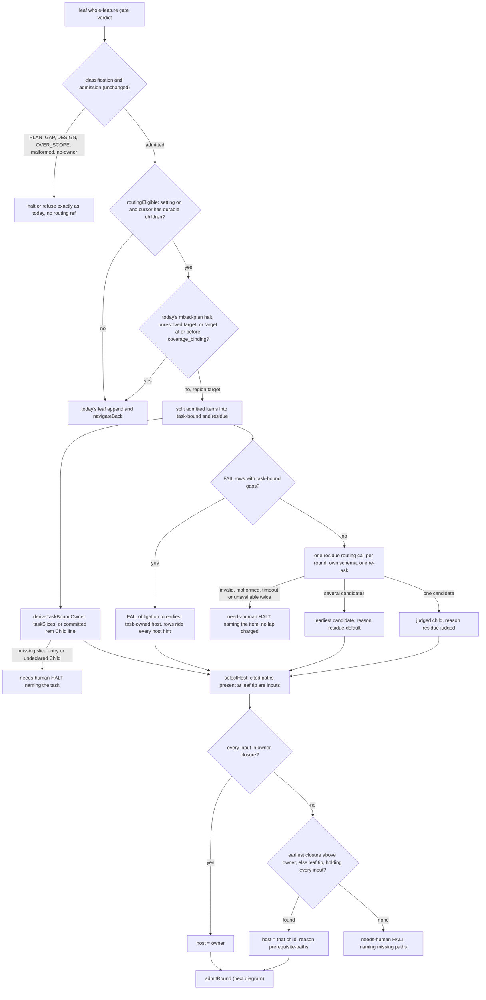
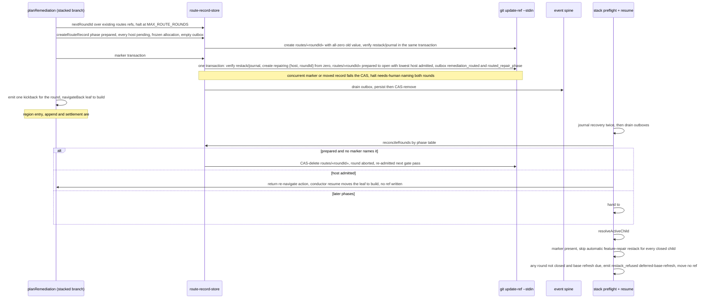
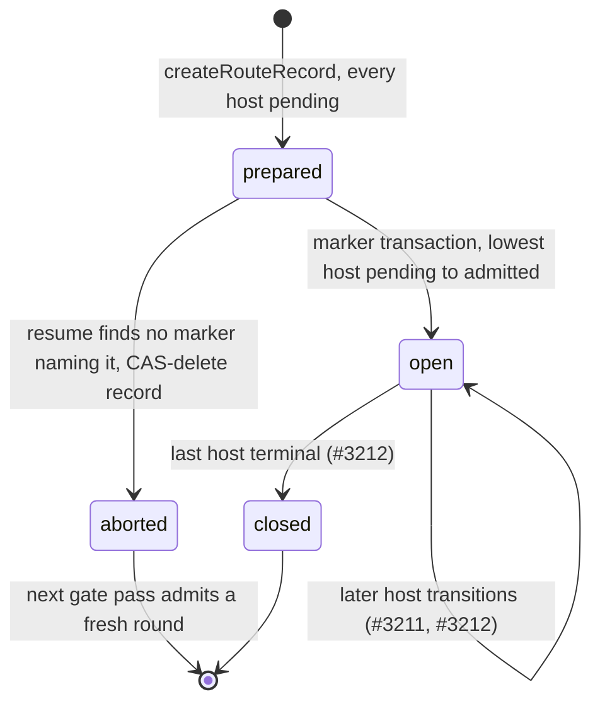
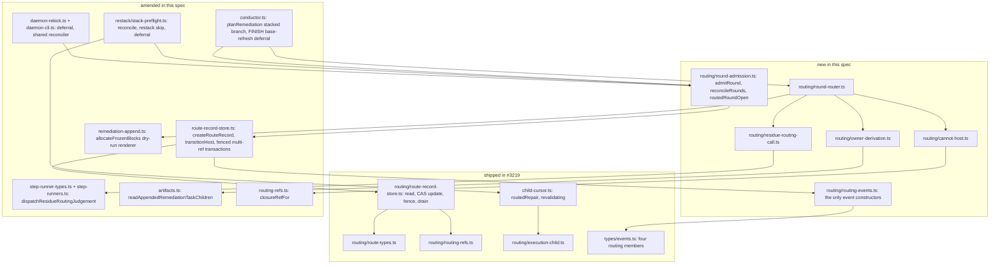

# Sequence + Components: Place admitted whole-feature fixes in the owning stacked child (#3210)

**Last updated:** 2026-10-14
**Scope:** Spec B of the four-spec split of `adr-2026-10-12-routed-whole-feature-repair`
(decision 18). It covers routing an admitted leaf-gate round to its owning and hosting children,
recording that decision durably before any mutation, admitting the first host marker-first, and
reconciling a crashed round on resume. The whole design is drawn in
[`whole-feature-audit-fixes-cannot-land-in-the-stack.md`](whole-feature-audit-fixes-cannot-land-in-the-stack.md);
these diagrams show only what this spec builds.

Covered (ADR decisions 1–4, 7, and the writers of 6 and 16):
- routing entry after today's classification, only for a feature with durable child state;
- mechanical owner derivation, the residue routing call, mixed rounds and cannot-host selection;
- route-record creation, the marker transaction, host and round phase transitions, and their event
  outbox entries;
- reconciliation by the phase table, the automatic-restack skip while a marker exists, and
  base-refresh deferral while a round is open.

Built on #2944 (shipped in #3219): route types and parsers, ref names and teardown, the store's
read, compare-and-swap update and restack-journal fence, the outbox drain, the cursor fields, the
execution-child resolver and the default-off `stacked_prs.route_whole_feature_fixes` setting.

Out of scope, delivered by #3211: host region entry and the frozen-block append, the `Round:`
stamp and `Child:`-line membership, the execution projection in the hook and `task-cli`, round
receipt settlement and taskless admission charging, the routed post-region custom-step kickback,
leaf-host processing, and the verified prerequisite reroute. Delivered by #3212: the routed exit
restack, the re-validation queue and the leaf return.

With the setting off, or when the cursor reports `no-child`, every path below collapses to today's
leaf remediation, byte for byte.

## Diagram: routing an admitted round

## Diagram: marker-first admission and resume reconciliation

## Diagram: phases written by this spec

## Diagram: components touched

## Legend

- **closure(k)** is `refs/conductor/«slug»/closed/c«k»`. This spec reads closure trees for
  cannot-host and never moves a closure.
- **Fenced write.** Every route-record write, including a multi-ref transaction that also creates
  the marker, passes the restack-journal fence in `route-record-store.ts`, and carries a `verify`
  line for `refs/conductor/«slug»/restack/journal` in the same transaction. An `applied` journal
  with a pending follow-on counts as open. The single exempt
  writer is the restack `applied` transaction, built in #3212.
- **open.** The marker transaction is the writer of round phase `open`, so reconciliation aborts
  only a `prepared` round with no marker, never an open round between hosts.
- **Events.** Each state change carries its event in the same blob's outbox; drains are
  at-least-once and deduplicated by `eventId`.

## Change Log

| Date | Change | Reason |
|------|--------|--------|
| 2026-10-14 | Initial generation | #3210 DECIDE |
| 2026-10-14 | Halt and target predicates first, atomic journal verify, recovery follow-on deferral | Architecture review round 2 (Codex) |
| 2026-10-14 | Routed event written at the marker; follow-on handled by the fence | Conflict check |
| 2026-10-14 | Components gain the frozen-block renderer, membership reader and closure-ref helper | Plan update |
