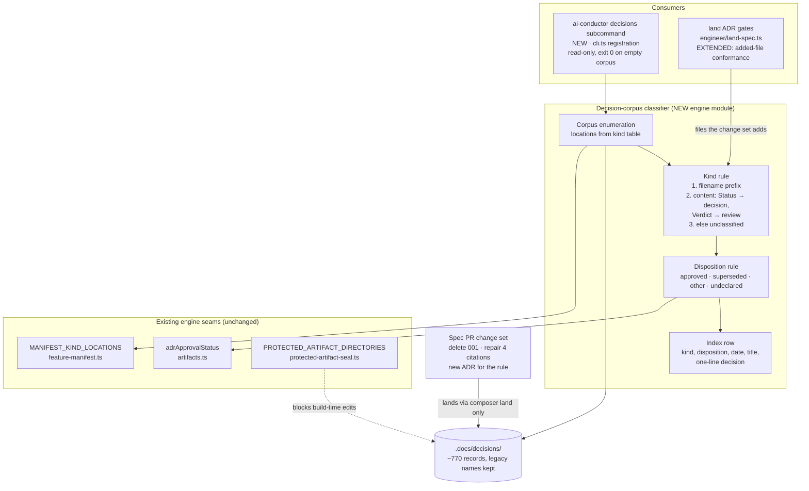
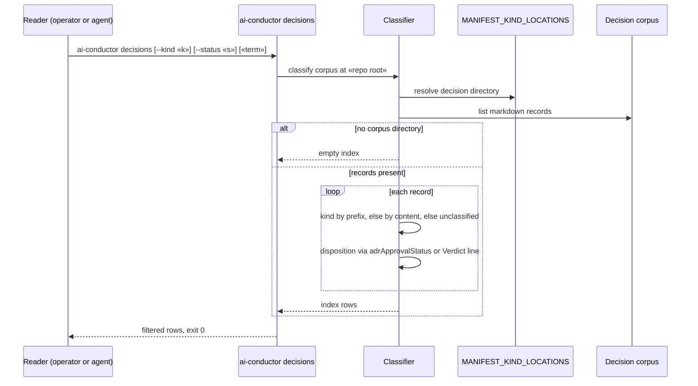

# Components: Decision-corpus query and conformance (#1480)

**Last updated:** 2026-11-07
**Scope:** The new read-only decision-corpus classifier and its two consumers: the
`ai-conductor decisions` CLI subcommand and the land gate's added-file conformance rule. Also shows
the one-time corpus change carried by the spec PR (deleting `001-harness-architecture.md` and
repairing its four citing records), which builds cannot make because `.docs/decisions` is a
protected-artifact directory.

## Diagram

## Sequence: `ai-conductor decisions`

## Legend

- **NEW / EXTENDED** mark the components this spec adds or changes; everything in *Existing
  engine seams* is reused unchanged.
- **Kind rule** is portable: it carries no repository-specific stem table, so consumer repositories
  with their own legacy ADRs classify without configuration.
- **Kind table**: corpus locations are read from `MANIFEST_KIND_LOCATIONS`, so a later layout move
  (#3419) or ADR relocation (#782) changes one table, not this module.
- The land conformance rule applies only to files the change set adds; existing records in every
  repository are grandfathered.
- Dashed edge: a constraint, not a call.

## Change Log

| Date | Change | Reason |
|------|--------|--------|
| 2026-11-07 | Initial generation | #1480 DECIDE (Medium tier) |
