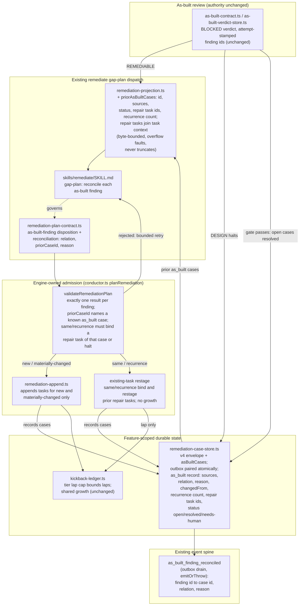
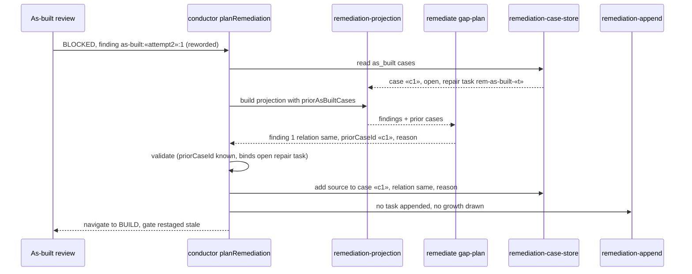

# Components: as-built finding reconciliation in the remediate gap-plan

**Last updated:** 2026-10-28
**Scope:** Proposed component boundaries for jstoup111/ai-conductor#3127.

- **What changes:** A BLOCKED as-built verdict already routes its REMEDIABLE findings through the
  remediate `gap-plan` dispatch (`planRemediation` in `conductor.ts`). That dispatch now also
  reconciles each current as-built finding against prior `as_built` cases in the shared remediation
  case store. Each finding is classed `same`, `recurrence`, `materially-changed` or `new`, with a
  reason.
- **What the engine enforces:** The engine validates the reconciliation and persists it as
  `as_built` case records. It appends plan tasks only for `new` and `materially-changed` findings.
  A `same` finding binds its prior case's open repair task. A `recurrence` restages its prior case's
  repair task. Neither draws plan growth. The gate's existing tier lap cap bounds repeated laps; no
  separate recurrence limit is added.
- **DESIGN findings:** These still halt `needs-human` without a dispatch. They are recorded as
  `as_built` cases with outcome `needs-human`.
- **Authority:** As-built review keeps its verdict authority. The gate passes only on an
  APPROVED-family or `plan-gap-delivered` verdict. Reconciliation never changes a verdict.
- **Unchanged:** The build_review case mode, the prd-widening-reconciliation mode, prd_audit
  references in `gap-plan`, and the as-built verdict contract.

## Diagram

## Sequence: a reworded finding on a later lap

## Legend

- **Solid arrows:** data or control flow. **Dotted:** governance (the skill text governs the
  provider output the contract validates).
- **«name»:** a variable value (attempt id, case id, task id).
- **Unchanged components** are named for context only: the as-built verdict contract, the
  kickback-ledger caps, and the build_review and prd-widening modes of remediate.
- The `as_built` record shape and its relation vocabulary are proposals that
  `/architecture-review` fixes in its ADR.

## Change Log

| Date | Change | Reason |
|------|--------|--------|
| 2026-10-28 | Initial generation | #3127 DECIDE (tier M): as-built finding reconciliation |
| 2026-10-28 | v4 envelope with asBuiltCases; events through the case-store outbox | Plan review PR-003 and PR-006 |
| 2026-10-28 | Dropped the separate recurrence limit; same/recurrence bind through existing-task restage | Architecture review: the tier lap cap already bounds laps |
