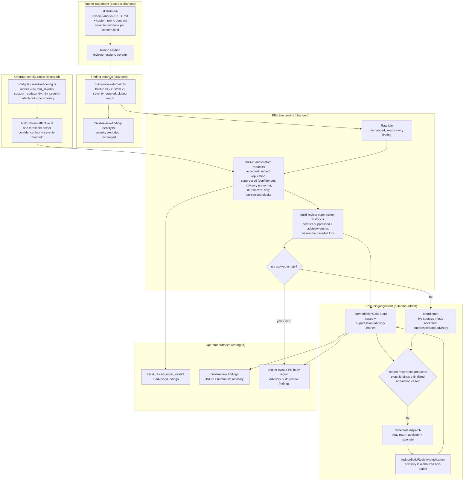

# Components: build_review finding severity and the per-rubric advisory threshold

**Last updated:** 2026-10-19
**Scope:** Proposed component boundaries for jstoup111/ai-conductor#3298. Every built-in and custom
rubric finding carries a required reviewer-assigned severity (critical, major, minor, nit). A
per-rubric `min_severity` lets the effective reducers classify below-threshold findings as advisory
before build_review fails. The adjudicator gains an `advisory` per-source outcome that downgrades a
finding with a rationale. Advisory findings are surfaced on the spine, the CLI and the PR body.
This extends the confidence-floor architecture
(`operator-configurable-confidence-floor-for-acting-.md`) in place and adds no new seam.

## Diagram

## Legend

- **Severity is reviewer-owned and immutable.** The engine never assigns, defaults or rewrites it, and
  identity excludes it, the same as confidence. Severity and confidence are independent.
- **Classification order.** The reducers check accepted, then settled, then declared replication, then
  the confidence floor (suppressed), then the severity threshold (advisory), then unresolved. A
  finding below both thresholds is recorded as *suppressed*, because it is not established as real.
  *Advisory* means real but below the operator's impact bar.
- **Missing severity is malformed, not silent.** The field is required in both schemas. A result
  without it fails parsing through the existing invalid-field path. A cached v3 or custom v1 result
  is discarded on the contract-version mismatch.
- **Undeclared threshold keeps today's behavior.** With no `min_severity`, the advisory bucket is
  always empty.
- **One threshold helper.** The duplicated built-in-only floor maps in `artifacts.ts` are folded into
  the shared helper, so the custom-rubric and gate-completion paths apply the same thresholds.
- **Adjudicator downgrade stays out of the finding.** `advisory` is a per-source case outcome with a
  rationale. The raw aggregate is never mutated. It is a finalized non-action outcome, so the
  existing settled-recurrence predicate keeps the same exact-id finding advisory on later laps
  without a new dispatch.
- **Never charged.** Threshold-advisory findings never reach the coordinator's live sources.
  Downgraded findings route no BUILD and charge no kickback.

## Change Log

| Date | Change | Reason |
|------|--------|--------|
| 2026-10-19 | Initial generation | Authored during DECIDE for jstoup111/ai-conductor#3298 |
