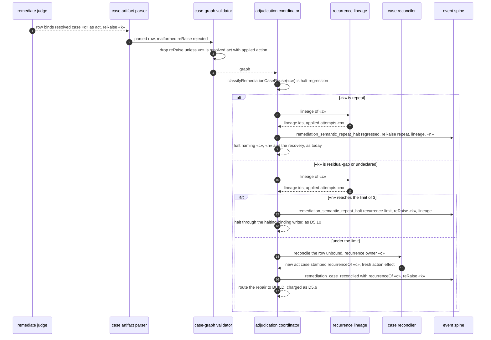
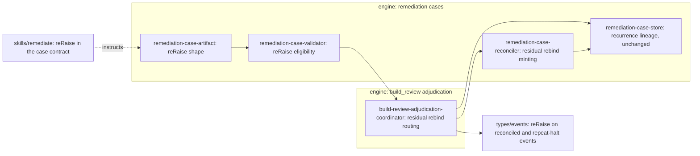

# Sequence + Components: a bound residual re-raise of a resolved action case routes to BUILD under the lineage limit (#3362)

**Last updated:** 2026-10-28
**Scope:** the post-join build_review adjudication of `adr-2026-08-29-mixed-build-review-laps-preserve-content-adjudication`
when a `remediate` judgement binds (`existingCaseId`) a resolved `act` case with an applied action
effect and proposes `act` again. Today `classifyRemediationCaseReuse` returns `halt-regression` and
the coordinator halts the lap `needs-human` as `regressed` before reconciliation, even when the judge
has planned an in-scope repair for a narrower residual gap (#3348, 2026-10-22). This spec adds:
- **A judge declaration.** Such a row may carry `reRaise: { kind: residual-gap | repeat, reason }`
  with a non-empty bounded reason. The artifact parser rejects a malformed shape. The validator drops
  a declaration on any row that does not bind a resolved `act` case with an applied action effect,
  and halts on none.
- **A split routing decision.** A `repeat` row halts before reconciliation as today. Its halt detail
  and `remediation_semantic_repeat_halt` event now name the bound case's lineage and its applied
  attempts. A `residual-gap` row, or a row with no declaration (reported `undeclared`), is a
  **residual rebind**. It joins the existing lineage-limit check (D5.10) with the bound case as its
  recurrence owner. At three applied attempts it halts as `recurrence-limit` through the existing
  halting-binding writer. Under the limit it is reconciled as a new `act` case stamped `recurrenceOf`
  the bound case. The new case reserves a fresh action effect, which the kickback budget charges
  exactly as D5.6 prescribes.
- **Spine reporting.** `remediation_case_reconciled` for the new case carries the declared
  `reRaise` kind and the bound case id. `remediation_semantic_repeat_halt` carries the kind (and,
  for `regressed`, the lineage and its applied attempts). No new event type, sink or sidecar.

The resolved bound row is never rewritten by a residual rebind. The store schema and version are
unchanged; `reRaise` is not persisted on the case. Unchanged: open-case `halt-repeat`
(`already-attempted`), non-`act` bindings, carry, refute and defer lanes, unbound exact and provenance
recurrence, `distinctFrom`, the cumulative kickback cap and #3461's bindable-disposition validation.

**Built on shipped code:** `classifyRemediationCaseReuse`, `classifyBuildReviewRecurrence`,
`buildReviewRecurrenceLineage`, `BUILD_REVIEW_RECURRENCE_ATTEMPT_LIMIT`, the coordinator's
`recordHaltingBinding` and `failUnlessAccepted`, `reconcileRemediationCases`' new-case minting with
`recurrenceOf`, and the `remediation_case_reconciled` and `remediation_semantic_repeat_halt` events.

## Diagram: a bound act re-raise of a resolved action case

## Diagram: components touched

## Legend

- «c» is the bound resolved `act` case id; «k» is the declared `reRaise` kind; «n» is the number of
  applied action attempts in the lineage of «c».
- **Residual rebind:** a bound `act` row on a resolved action case whose `reRaise` is `residual-gap`
  or absent. It is reconciled as a new case, never as an edit of «c».
- **Lineage limit:** `BUILD_REVIEW_RECURRENCE_ATTEMPT_LIMIT`, a fixed engine constant of 3.

## Change Log

| Date | Change | Reason |
|------|--------|--------|
| 2026-10-28 | Initial generation | #3362 DECIDE, approach B |
