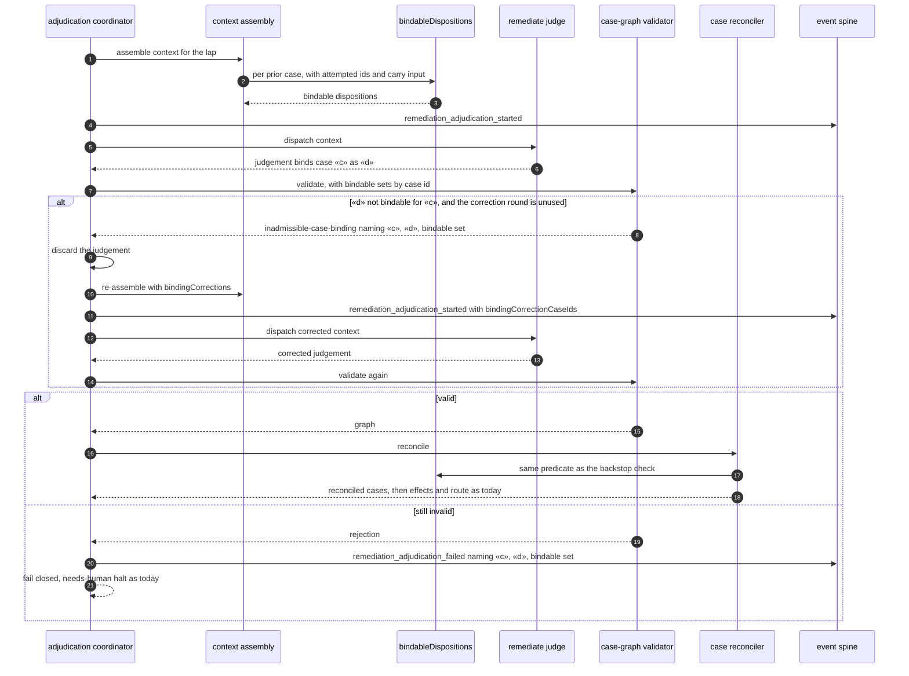
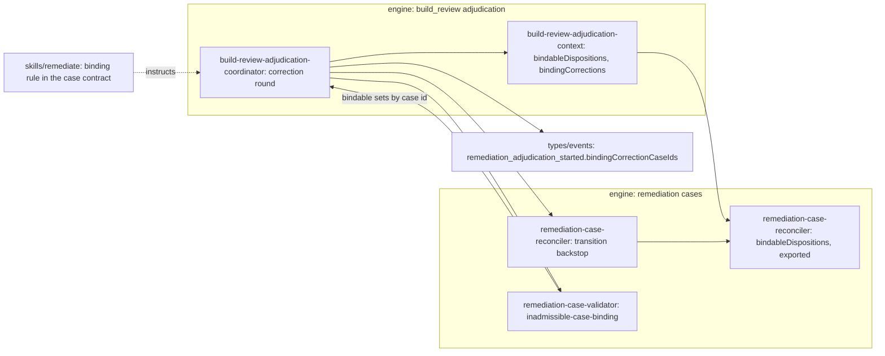

# Sequence + Components: a corrected re-judgement for an inadmissible build_review case binding (#3461)

**Last updated:** 2026-10-28
**Scope:** the post-join build_review adjudication of `adr-2026-08-29-mixed-build-review-laps-preserve-content-adjudication`
D2 when a `remediate` judgement binds a prior case (`existingCaseId`) with a disposition that the case
reconciler does not admit for that case. Today the judgement passes graph validation, then
`reconcileRemediationCases` refuses it as `illegal-disposition-transition` and the lap halts
`needs-human`. This spec adds:
- **One predicate.** `bindableDispositions(record, { attempted, carryEligible })` in the reconciler
  module states which dispositions a binding to that case can take. It is the disposition itself,
  plus `refute` on an open, attempted, applied action, plus `defer` on an applied action; a
  carry-eligible case admits every disposition. The reconciler's own transition check calls it.
- **Context.** Every `priorCases[]` entry carries `bindableDispositions`. A correction round also
  carries `bindingCorrections`: one entry per refused binding, naming `caseRef`, `existingCaseId`,
  the proposed disposition and the bindable set.
- **Validation.** The validator refuses a non-escalation row whose `existingCaseId` disposition is
  outside that case's bindable set, as `inadmissible-case-binding`. The check runs after every other
  check, so the reason is reported only when it is the judgement's sole defect.
- **One correction round.** On that refusal, the coordinator discards the judgement and re-dispatches
  the same `remediate` judgement once per lap, with the refused bindings named. The correction round
  is independent of the existing expansion round, so a lap makes at most three judge dispatches. A
  second invalid judgement fails closed and its halt names the case, the proposed disposition and the
  bindable set.

The reconciler's `illegal-disposition-transition` check stays as a backstop. The refute lane's
evidence rules, the refutation-repeat halt, the semantic repeat and regression halts, carry and
escalation are unchanged.

**Built on shipped code:** `coordinateBuildReviewAdjudication`'s two-round loop and its expansion
round (`classifyIndexOnlyAdmission`), `assembleBuildReviewAdjudicationContext`,
`validateRemediationCaseGraph`, `reconcileRemediationCases`, `classifyRemediationCaseReuse`,
`isCarryEligibleRemediationCase`, and the `remediation_adjudication_started` event.

## Diagram: inadmissible binding, correction round, reconciliation

## Diagram: components touched

## Legend

- «c» is a prior case id; «d» is the disposition the judgement proposes for it.
- **Bindable:** a disposition the reconciler admits for a binding to that case. Escalation rows are
  outside the check, because they never reach the reconciler.
- **Correction round:** one discarded-then-re-dispatched judgement per lap; it charges no kickback.

## Change Log

| Date | Change | Reason |
|------|--------|--------|
| 2026-10-28 | Initial generation | #3461 DECIDE, approach A |
