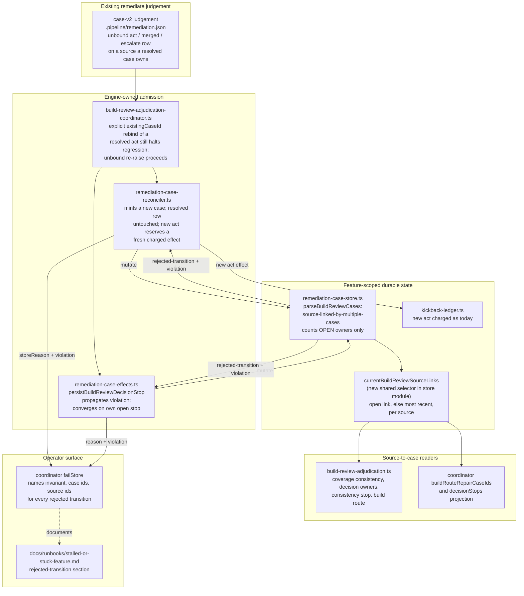

# Components: open-scoped source ownership for build_review remediation cases

**Last updated:** 2026-10-19
**Scope:** Proposed component boundaries for jstoup111/ai-conductor#3292, which also delivers the
core outcome of #2464. The case store refuses a source only when two OPEN cases link it. A single
shared selector makes a source's open link, or else its most recent link, authoritative for every build_review
source-to-case reader. An unbound re-raise of a source that only resolved cases own is admitted as a
new case. Decision-stop persistence propagates rejected-transition violations and converges on a
replay. No new module, store version or schema field is added.

## Diagram

## Legend

- **Judge**: provider-authored input. The engine never infers sameness or distinctness from its prose.
- **Admit**: existing engine seams. Only their admission rules change.
- **State**: the one durable case store. `currentBuildReviewSourceLinks` is a pure selector in the
  existing store module, not a new module.
- **Readers**: every build_review consumer that maps a source back to one case reads through the
  selector instead of scanning all links.
- **Halt**: the rejected-transition diagnostic now reaches the operator on every path.

## Change Log

| Date | Change | Reason |
|------|--------|--------|
| 2026-10-19 | Initial generation | #3292 DECIDE (Medium) |
