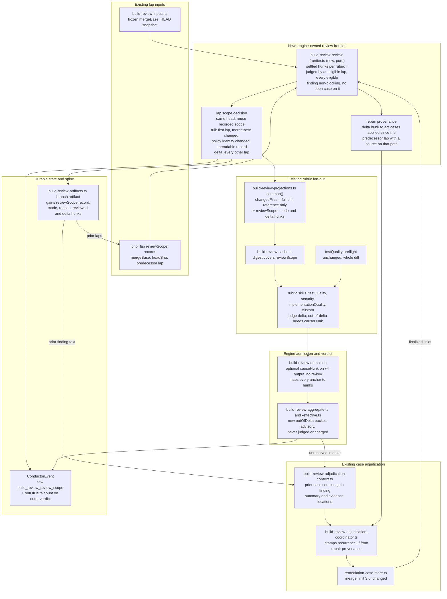

# Components: lap-monotonic build_review review scope

**Last updated:** 2026-10-24
**Scope:** Proposed component boundaries for jstoup111/ai-conductor#3294.

After a feature's first build_review lap, every rubric judges only the delta. The delta is the set
of feature-diff hunks that no earlier lap has settled. The full diff stays available as reference
context. The engine decides the scope and records it durably, and it enforces admission of
findings. A later-lap finding anchored in a settled hunk blocks only when it names a cause hunk that
is in this lap's delta. A finding in a hunk changed by a repair joins the repaired case's #3124
recurrence lineage, and the engine derives that from repair provenance, not finding ids. The
remediate judge also sees the summaries and locations of prior findings. Rubrics still receive no
case history.

## Diagram

## Legend

- **Frontier** is new pure logic. It derives the settled set from the prior lap branch artifacts
  and the case store, and it keeps no ledger of its own. The settled set is a union over laps, so
  it does not depend on lap order. A hunk
  is identified by path and its `+`/`-`-only content hash (`contentHashForHunk`), so it survives
  line shifts and pure rebases.
- **Inputs:** any change of merge base since the prior reviewed lap forces a full lap, whatever the
  rebase cause. The cause cannot be trusted, because a restacked child is stamped `feature-repair`
  even when its base moved. A first lap, a missing or unreadable record, or a change of the
  rubric's policy identity (versions, skill or policy bundle, provider, model, effort) also falls
  back to a full lap. A re-lap at the same head reuses its recorded scope. Uncertainty fails toward reviewing more.
- **Review:** rubrics receive a mechanical scope, never case history or prior findings. A hunk
  with an unfinalized finding is never settled, so a lap reviews it again in full.
- **Admit:** security and implementationQuality anchors are hunks. Custom source regions and
  testQuality test regions map to the hunks they intersect, falling back to file level. The engine
  checks only that a named `causeHunk` is in the delta. Whether that hunk
  really causes the defect is the reviewer's judgement. A finding with no valid cause is recorded
  as advisory, and it neither kicks back nor charges. A `critical` finding is never out of delta.
- **Judge:** a new `act` case in a delta hunk joins the lineage of an act case that was applied
  since the predecessor lap and has a source on the same path. With several candidates, the one
  with the most applied attempts wins. Prior source digests are budgeted inside the existing
  256 KiB context cap. The judge may still declare `distinctFrom` with a reason (#3124).
- **State/spine:** the `reviewScope` record is durable state read by name, which is exception C
  of the event-spine skill. The scope decision itself is emitted on the spine.

## Change Log

| Date | Change | Reason |
|------|--------|--------|
| 2026-10-24 | Initial component diagram | #3294 lap-monotonic build_review scope |
