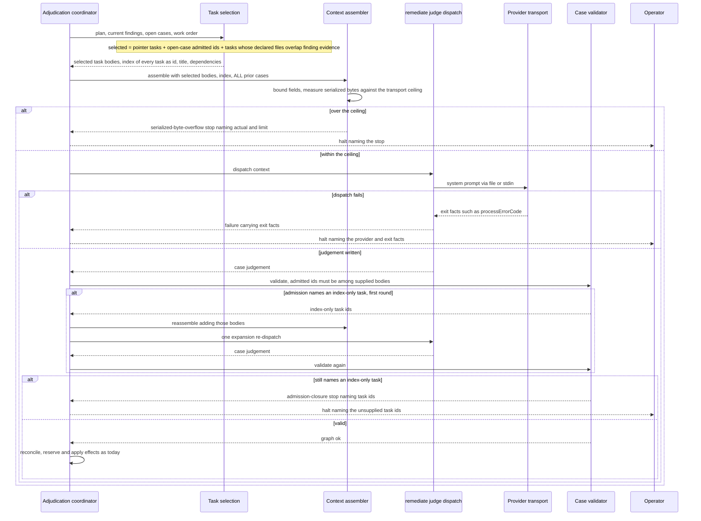

# Sequence: build_review remediate context scoped to the findings

**Last updated:** 2026-10-19
**Scope:** Proposed flow for #3291. The post-join `remediate` judgement receives full plan-task
bodies only for the tasks its findings and open cases touch, plus an index of every plan task.
The engine allows admission only to tasks whose body was supplied, and runs at most one
expansion re-dispatch when the judge names a task it saw only in the index. The engine checks
the serialized context against a ceiling the dispatching transport can deliver. An over-limit
context or a failed dispatch halts with a named, operator-readable reason. Prior-case history
stays complete (adr-2026-09-10-portable-build-review-policy). There is no new process, store,
persisted schema, or CLI surface. The flow extends the adjudication coordinator, the context
assembler, the case validator, and the conductor's judge dispatch.

## Diagram

## Legend

- **Task selection** is new engine logic inside the coordinator boundary. It is deterministic and
  makes no LLM call.
- **Index** lists every active plan task by id, title, and declared dependencies, with no body.
  The judge can cite an index-only task, but cannot admit work against one without the expansion
  round.
- **Transport ceiling** is the byte limit the dispatching provider transport declares it can
  deliver. The existing `serialized-byte-overflow` stop reports it.
- The **expansion round** is bounded to one re-dispatch per lap. Every other step after
  validation (reconcile, effects, work order, kickback charge) is unchanged.

## Change Log

| Date | Change | Reason |
|------|--------|--------|
| 2026-10-19 | Initial generation | #3291: remediate context scales with the plan, not the findings |
