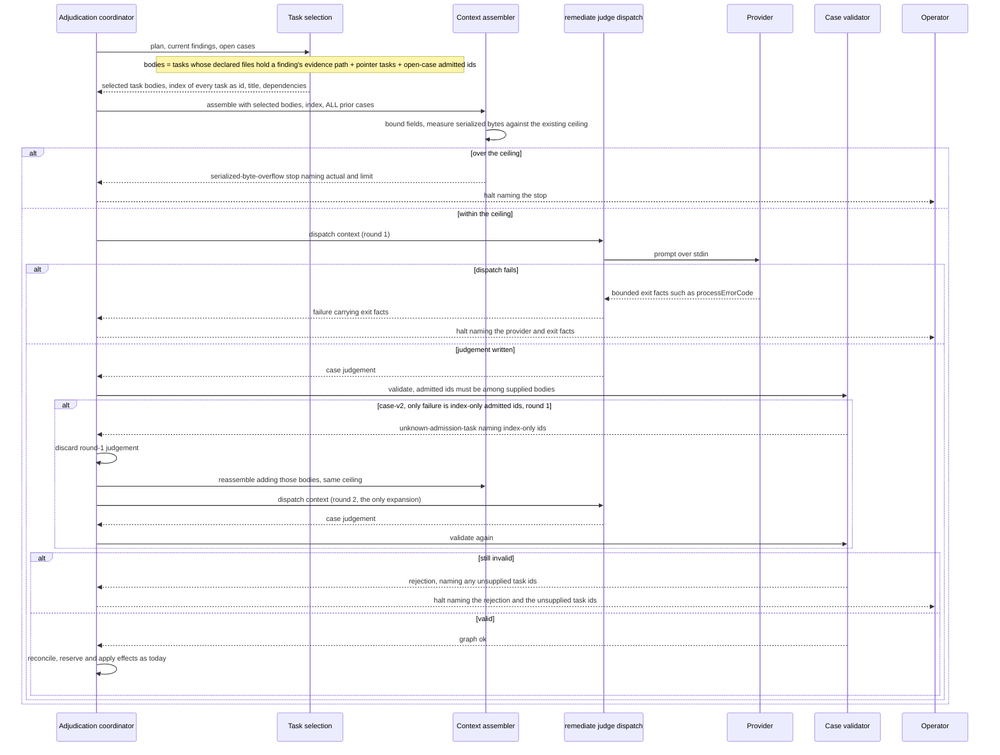

# Sequence: build_review remediate context scoped to the findings

**Last updated:** 2026-10-23
**Scope:** Proposed flow for #3291. The post-join `remediate` judgement receives full plan-task
bodies only for the tasks its findings and open cases touch, plus an index of every plan task.
The existing admission check accepts only supplied task ids. When a case-v2 judgement fails only
because it admits index-only tasks, the coordinator discards it and re-dispatches the same
judgement once with those bodies added. The existing serialized-byte ceiling still applies to
every round. A failed dispatch halts with the provider's bounded exit facts. Prior-case history
stays complete (adr-2026-09-10-portable-build-review-policy). There is no new process, store,
persisted schema, or CLI surface. The flow extends the adjudication coordinator, the context
assembler, the case validator, and the conductor's judge dispatch.

## Diagram

## Legend

- **Task selection** is new engine logic inside the coordinator boundary. It is deterministic,
  reuses the existing plan parsers, and makes no LLM call.
- **Index** lists every active plan task by id, title, and declared dependencies, with no body.
  The judge can cite an index-only task, but cannot admit work against one without the expansion
  round.
- **Ceiling** is the existing `maxSerializedBytes` context limit. Every provider already delivers
  the prompt over stdin, so no per-transport ceiling is introduced.
- The **expansion round** happens at most once per lap and only for case-v2, the only mode with an
  admission contract. Round 1's judgement is discarded, never merged. Every step after validation
  (reconcile, effects, work order, kickback charge) is unchanged, and the expansion charges no
  kickback.

## Change Log

| Date | Change | Reason |
|------|--------|--------|
| 2026-10-19 | Initial generation | #3291: remediate context scales with the plan, not the findings |
