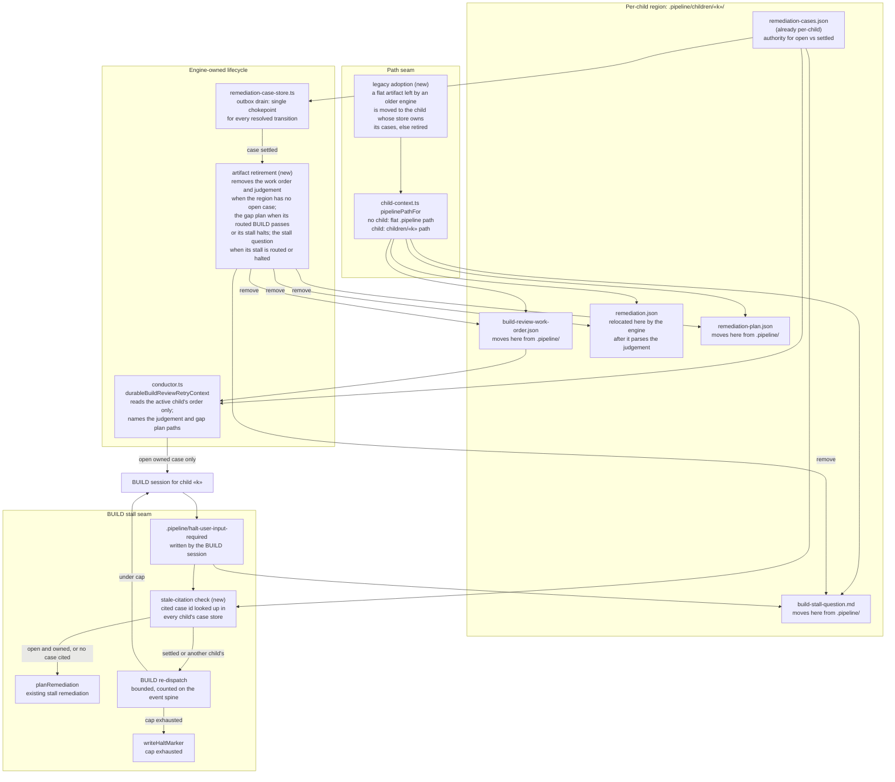
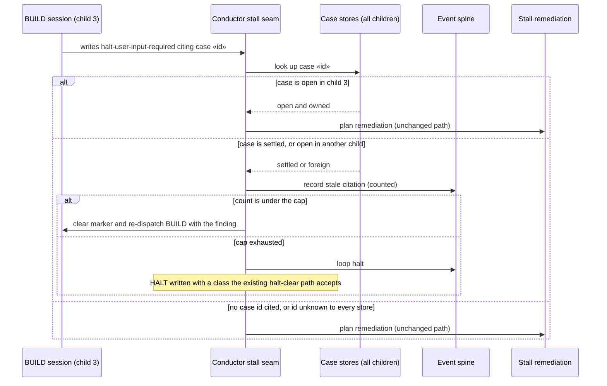

# Components: live remediation state is owned and open by construction

**Last updated:** 2026-11-15
**Scope:** Proposed component boundaries for jstoup111/ai-conductor#3658. The four remediation
inputs a BUILD session can reach — the build-review work order, the case judgement, the typed gap
plan, and the captured stall question — move from the feature-level `.pipeline/` directory into the owning child's region, and
leave the live path once nothing open depends on them. The BUILD stall seam checks a cited case
against the case stores before it asks for a remediation plan. No new module layer, service,
dependency, CLI command, or settings key is added.

## Diagram

## Sequence: a stall that cites a settled or foreign case

## Legend

- **Per-child region**: state one child's BUILD owns. A whole-feature run with no child keeps the
  flat `.pipeline/` path through the same seam, and the same retirement applies.
- **Path seam**: the existing child-path helper. Legacy adoption is the only compatibility read;
  it runs for features an older engine left mid-remediation.
- **Engine-owned lifecycle**: the case store stays the authority. Retirement removes files; the
  case records and the event log remain the durable record of what happened.
- **BUILD stall seam**: the stale-citation check sits after the engine reads the stall question and
  before it clears the marker or dispatches remediation.
- **(new)**: behaviour this spec adds inside existing modules.

## Change Log

| Date | Change | Reason |
|------|--------|--------|
| 2026-11-15 | Initial generation | Proposed design for jstoup111/ai-conductor#3658 |
| 2026-11-15 | Added the stall question as a fourth region input; gap plan kept until its routed BUILD passes; prompt names the readable inputs | Conflict-check resolutions and the implementation plan |
