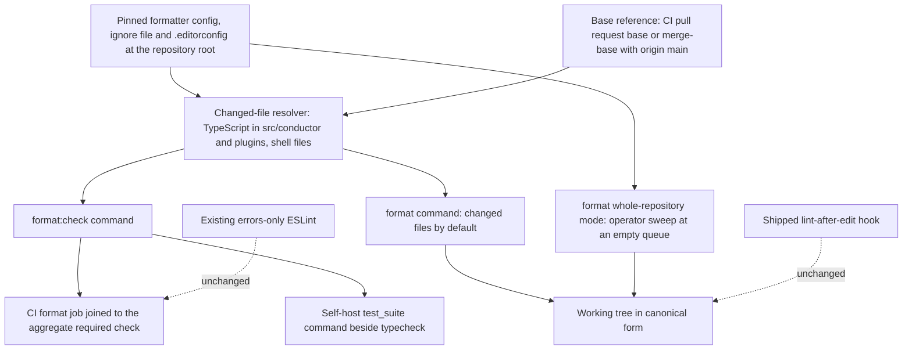

# Components: Changed-file formatting enforcement

**Last updated:** 2026-11-07
**Scope:** Proposed developer-tooling components for #1991. Harness-repository-only; no engine module, persisted format, deployment unit, or consumer-shipped surface changes.

## Diagram

## Responsibilities and limits

The formatter configuration is the single definition of canonical form; the check and write commands read the same pinned version and configuration, so a file `format` writes always passes `format:check`. The resolver alone decides the file set: TypeScript under `src/conductor/` and `plugins/`, plus shell scripts, filtered to files added or modified against the base reference. Deleted files and files outside those types are never checked.

`format:check` is a read-only gate. It runs in two places that must agree: the CI job (base is the pull request base) and the self-host `test_suite` (base is the merge-base with the default branch), so a daemon build fails before a pull request exists rather than after it ships. Whole-repository mode exists only on the write command and is run by the operator; no reformat commit is part of this change.

ESLint keeps its errors-only bug-class policy and gains no style rule. The consumer-shipped `lint-after-edit.sh` hook is not changed.

## Evidence and design status

Verified: no prettier, biome, dprint, or `.editorconfig` exists on `origin/main` at 5418c8254f; `ci.yml` runs `typecheck` as its own job joined to the aggregate check; `.ai-conductor/config.yml` `test_suite.commands` and `changed_command` both lead with typecheck. Measured: a whole-repository dry run rewrites 2,294 of 2,562 TypeScript files with prettier at width 120 and 2,308 with Biome at width 120.

Open for architecture review: formatter tool and version (including whether shell formatting is npm-delivered or a system binary), line width, and how the base reference is supplied in each enforcement point.

## Legend

Solid edges are new data or control flow. Dotted edges mark existing components that this change deliberately leaves unchanged.

## Change Log

| Date | Change | Reason |
|---|---|---|
| 2026-11-07 | Initial component proposal | Operator chose changed-file enforcement as a command run like typecheck |
