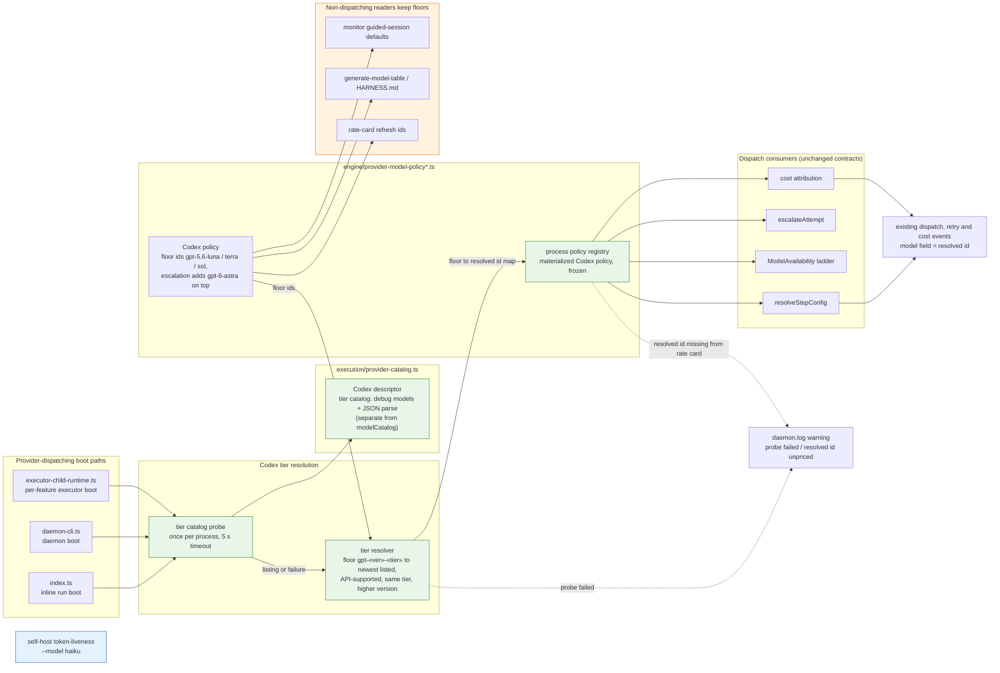
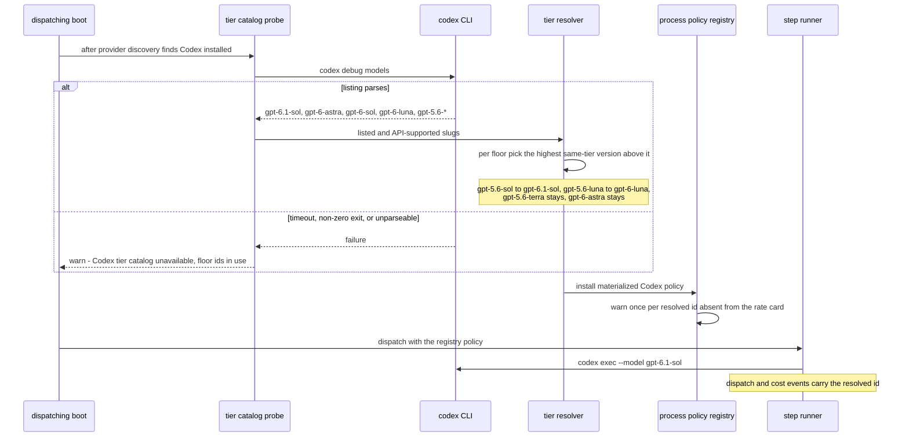

# Components + Sequence: Codex Tier Model Resolution

**Last updated:** 2026-10-25
**Scope:** How the built-in Codex model policy's pinned ids become per-tier floors that each
provider-dispatching process upgrades, once, to the newest model of the same tier listed by the
Codex CLI's own catalog (`codex debug models`). Also covers the Claude self-host token-liveness
probe moving to the `haiku` alias.

## Component Diagram

## Sequence: Dispatching boot upgrades Codex floors

## Legend

- **Green** — new resolution machinery.
- **Orange** — readers that never probe (adr-2026-09-24 D8 non-dispatching paths, and monitor
  launch, which is out of scope) keep the floor ids, today's behavior.
- **Blue** — the Claude token-liveness probe moves from `claude-haiku-4-5-20251001` to the
  version-free `haiku` alias the Claude CLI resolves itself.
- A policy id is a floor only when it parses as `gpt-«version»-«tier»`; anything else stays
  opaque. A floor is replaced only by a strictly newer version of the same tier, so terra stays
  `gpt-5.6-terra` until a newer terra is listed, and no tier is ever substituted for another.
- Resolution is per process, like the `ModelAvailability` dead-model cache; a restart re-probes.
  No file, sidecar, or new event type is added: the resolved id travels in the model fields that
  existing dispatch, retry, and cost events already carry.
- Operator-configured provider-native ids (`llm_providers.codex.*`, step `model`, explicit
  ladders) stay opaque and keep their existing precedence over policy defaults.
- The reactive fallback ladder walks resolved ids, so `sol to terra to luna` degrades from the
  newest sol.

## Change Log

| Date | Change | Reason |
|------|--------|--------|
| 2026-10-25 | Initial generation | DECIDE architecture for Codex tier model resolution |
