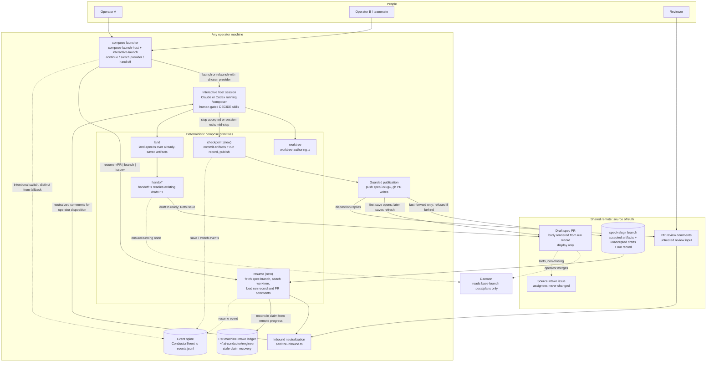
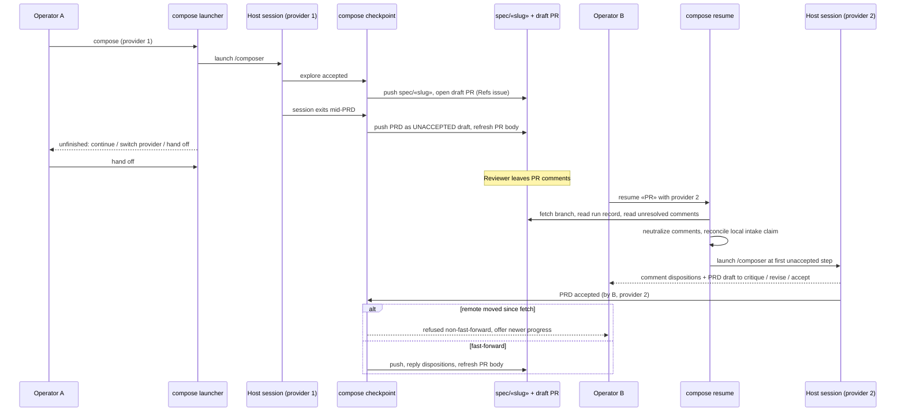

# Components and Sequence: Composer run checkpoint, resume, provider switch, and hand-off

**Last updated:** 2026-11-07
**Scope:** How a Composer run is saved, made visible, and resumed across sessions, providers, machines,
and operators (#2050). The diagram shows the planned structure. Where the run record is stored and how
events are shaped are decided by architecture-review.

## Diagram

## Legend

- **Source of truth.** The `spec/«slug»` branch on the shared remote holds all run state: accepted
  artifacts, unaccepted drafts, and the run record. The draft PR body is rendered from that record and
  is never read back as state.
- **New components:** `checkpoint` and `resume`, plus the launcher's between-session choice.
  Everything else exists today and changes behavior: `worktree` reuses a checkpointed run, `land` works
  over artifacts that are already saved, and `handoff` readies an existing draft PR instead of creating
  one.
- **Dashed edges** are telemetry or side effects. The run's save, resume, and switch events extend the
  existing event spine; no parallel channel is added.
- **Concurrency.** There is no ownership lock. A publication that is not a fast-forward is refused, so
  newer progress is never overwritten.
- **Daemon isolation.** The daemon discovers only `.docs/plans` on the base branch
  (`daemon-backlog.ts`), so an in-progress, unmerged spec branch is invisible to it.

## Change Log

| Date | Change | Reason |
|------|--------|--------|
| 2026-11-07 | Initial generation | #2050 DECIDE architecture-diagram step |
