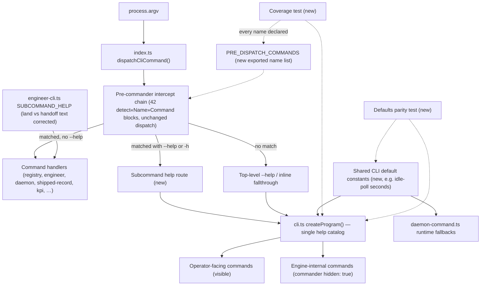
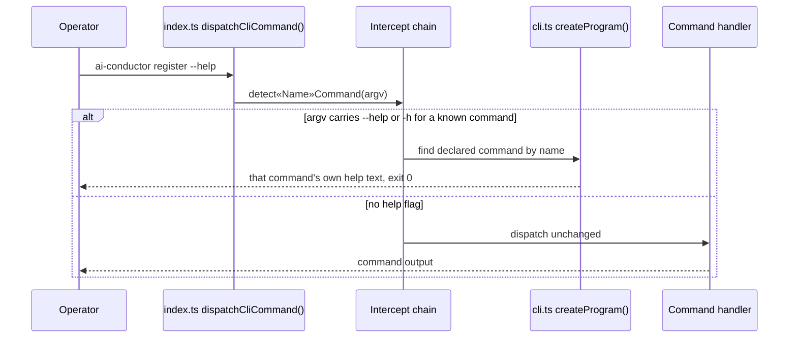

# Components and sequences: CLI help catalog matches dispatch

**Last updated:** 2026-10-14
**Scope:** To-be CLI entry surface for jstoup111/ai-conductor#1012. Feature:
`conduct-ts-help-disagrees-with-behavior-in-six-pla`. Covers `src/conductor/src/index.ts`
(`dispatchCliCommand()` and its pre-commander `detect*Command` intercept chain), `src/conductor/src/cli.ts`
(`createProgram()` and `renderCanonicalFullHelp()`), `src/engine/engineer-cli.ts`
(`SUBCOMMAND_HELP`), and `src/engine/daemon-command.ts` (daemon runtime flag fallbacks). The 42
intercept dispatch blocks themselves are unchanged (Approach A); only their `--help` behavior and
their declaration in commander change.

## Component diagram

## Sequence: subcommand --help

## Legend

- **Intercept chain:** the existing `detect«Name»Command(process.argv)` blocks in `dispatchCliCommand()` and `dispatchNonDispatchingCliCommand()` that run
  before commander parses; their dispatch logic is untouched.
- **PRE_DISPATCH_COMMANDS:** an exported list of the top-level names the chain intercepts; the
  coverage test fails when a name is not declared in `createProgram()` (visible or hidden).
- **Shared default constants:** one source for a flag's declared default and its runtime fallback,
  starting with `--idle-poll` (declared `'5'` in `cli.ts`, runtime `60` in `daemon-command.ts`).
- Dotted edges are test-time checks, not runtime calls.

## Change Log

| Date | Change | Reason |
|------|--------|--------|
| 2026-10-14 | Initial generation | Approach A for jstoup111/ai-conductor#1012 |
