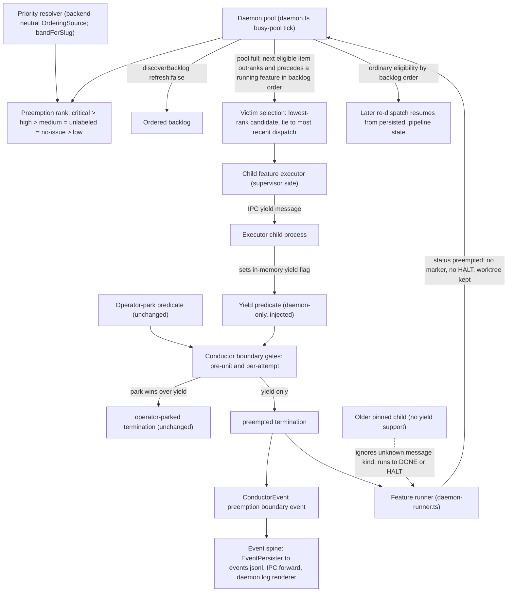
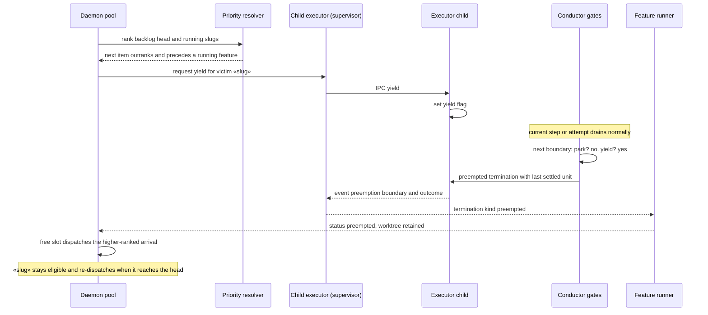

# Components and sequences: Daemon preemption of lower-priority work at step boundaries

**Last updated:** 2026-11-07
**Scope:** To-be preemption path for jstoup111/ai-conductor#1929. Feature:
`daemon-cannot-switch-to-higher-priority-queued-wor`. Covers the daemon pool's busy-pool tick, the
child feature executor's IPC channel (adr-2026-10-15-per-dispatch-engine-pinned-executor), the
conductor's operator-park boundary gates (adr-2026-07-29-operator-park-scheduling-unit-boundary),
the feature runner's outcome mapping, and the event spine. The in-process executor is out of scope
(removed by #3403). Operator park itself is shown only to mark it unchanged.

## Component diagram

## Sequence: preempting a running feature

## Legend

- Solid arrows: new or changed flow. Dotted arrow: compatibility path for an older pinned child.
- "Unchanged" nodes keep their current behavior; operator park takes precedence over yield at the
  same boundary.
- `«slug»` marks a variable feature slug.

## Change Log

| Date | Change | Reason |
|------|--------|--------|
| 2026-11-07 | Initial generation | DECIDE for #1929 (Approach B, IPC yield) |
| 2026-11-07 | Victim needs strictly higher rank and earlier backlog order | Conflict-check amendment to ADR decision 2; plan update |
