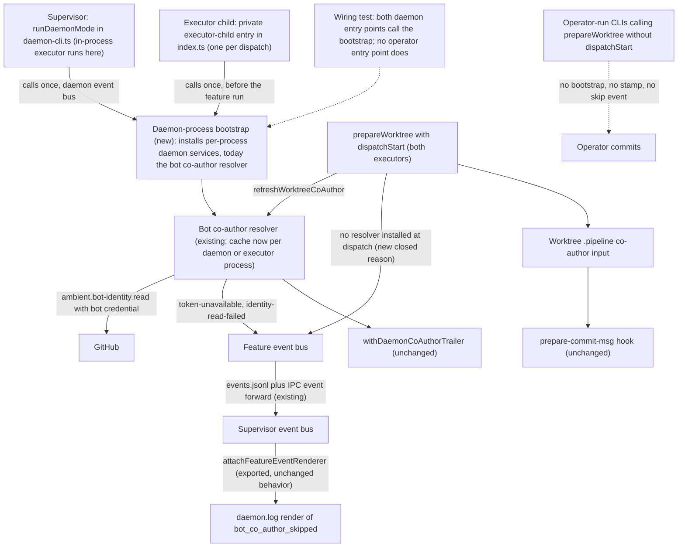
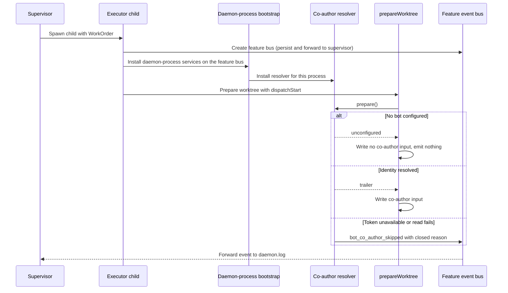
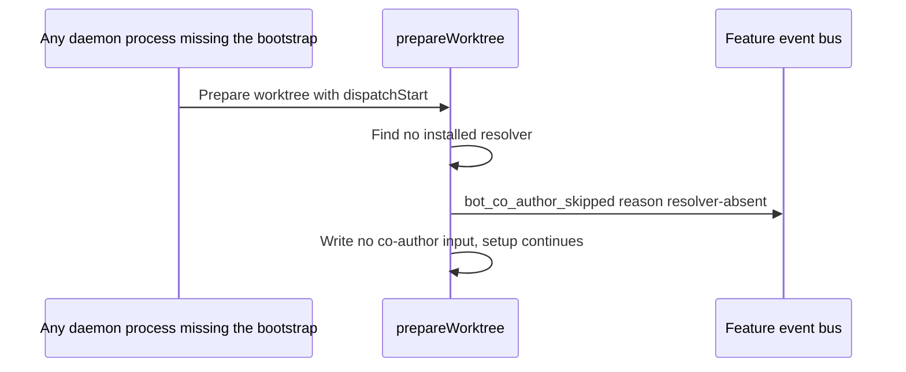

# Components and sequences: Daemon commits carry no bot co-author trailer under child isolation

**Last updated:** 2026-10-24
**Scope:** The to-be wiring of the bot co-author resolver into every daemon process that
dispatches features, for jstoup111/ai-conductor#3377. Feature:
`daemon-commits-carry-no-bot-co-authored-by-trailer`. Covers the shared daemon-process bootstrap,
the supervisor (`daemon-cli.ts`) and executor-child (`index.ts` private `executor-child` branch)
entry points, the dispatch-time absent-resolver skip, and the child-to-supervisor event path. The
resolver itself, the trailer format, the `prepare-commit-msg` hook, and the engine commit helper
are unchanged from `daemon-commits-co-authored-by-the-configured-bot.md` and appear only for context.

## Component diagram

## Sequence: child-isolated dispatch

## Sequence: dispatch with no resolver installed (defect guard)

## Legend

- **new**: introduced by this feature. **existing**/**unchanged**: shipped by #2839 or earlier.
- Solid arrows are production calls or data flow; dotted arrows are tests or paths deliberately left
  untouched.
- "Feature event bus" is the child-owned `ConductorEventEmitter` created in `executor-child.ts`,
  which persists to the worktree `.pipeline/events.jsonl` and forwards every event to the supervisor.

## Change Log

| Date | Change | Reason |
|------|--------|--------|
| 2026-10-24 | Initial generation | DECIDE for #3377 (approach C: shared daemon-process bootstrap) |
| 2026-10-24 | Feature-bus renderer shown as exported `attachFeatureEventRenderer` | Plan Task 7 lifts it out of `runDaemonMode` so supervisor rendering is testable |
