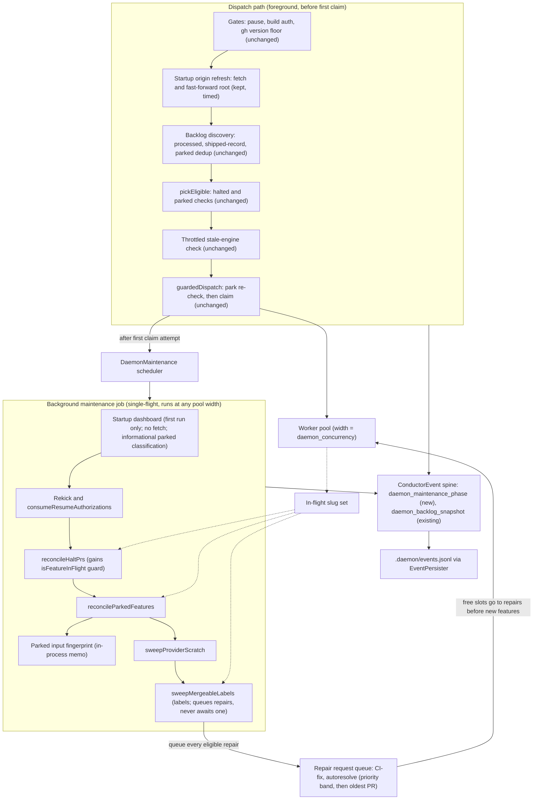
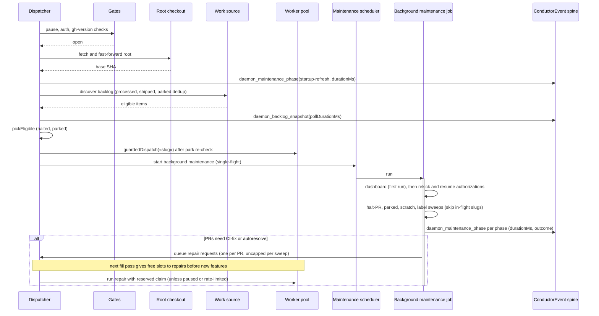
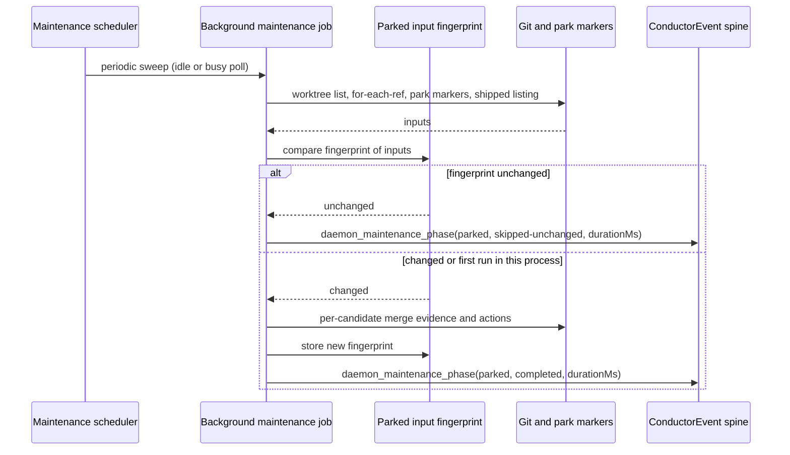

# Components and sequences: Dispatch-first daemon maintenance

**Last updated:** 2026-10-14
**Governing ADR:** adr-2026-10-14-dispatch-first-daemon-maintenance
**Scope:** The target startup and per-tick scheduling of daemon maintenance for
jstoup111/ai-conductor#1174. Feature: `daemon-reconciliation-delays-first-feature-dispatc`.
Covers the dispatcher in `engine/daemon.ts`, the `DaemonMaintenance` scheduler, the startup
dashboard wiring, the best-effort reconcilers, the CI-fix and autoresolve repair sessions, and
phase-duration telemetry on the existing `ConductorEvent` spine. Discovery internals and the
safety checks are shown only to mark that they are unchanged and stay on the dispatch path.

## Component diagram

## Sequence: daemon startup to first dispatch

## Sequence: repeat scan with unchanged parked inputs

## Legend

- **Dispatch path:** the only work allowed between scan start and the first claim. Each of its
  safety checks is unchanged. The startup origin refresh stays on this path so discovery's
  shipped-record dedup sees merges that landed while the daemon was down.
- **Background maintenance job:** at most one runs at a time, at any pool width. It starts
  after the first claim attempt and keeps each reconciler's existing never-throw contract. Every
  mutating reconciler skips in-flight slugs.
- **Repair request queue:** CI-fix and autoresolve provider sessions no longer run inline inside
  the label sweep. Every eligible repair is queued, at most one per pull request. The dispatcher
  gives free slots to repairs before new features, ordered by priority band and then oldest pull
  request. Each running repair holds a reserved claim, so `daemon_concurrency` bounds repairs
  too. Pause and rate-limit episodes block repair claims.
- **Parked input fingerprint:** an in-process memo, never a sidecar file. The first run in each
  daemon process always does the full reconcile.
- **`daemon_maintenance_phase`:** a new `ConductorEvent` variant carrying `phase`, `durationMs`,
  and `outcome`. It extends the one spine; no new channel is added.
- `«slug»` marks a variable value.

## Change Log

| Date | Change | Reason |
|------|--------|--------|
| 2026-10-14 | Initial generation | #1174 dispatch-first maintenance design |
