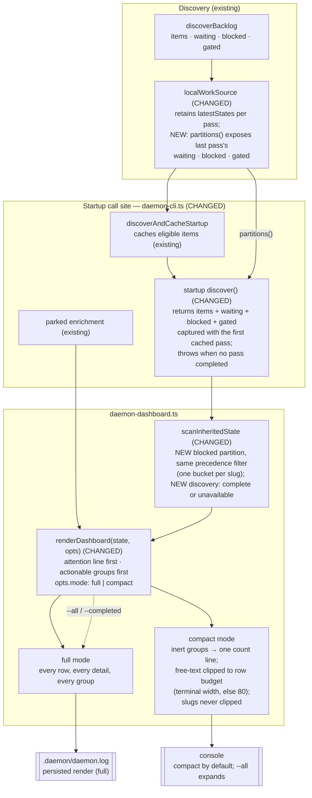

# Components: Daemon startup dashboard readability

**Last updated:** 2026-10-24
**Scope:** How the daemon's startup inherited-state dashboard gets its partitions and is rendered
twice, once in full for `.daemon/daemon.log` and once compact for the console. It covers the
startup call site (`createStartupDashboard` in `src/daemon-cli.ts`), the local `WorkSource`
adapter (`src/engine/daemon-work-source.ts`), the inherited-state scan, and `renderDashboard`
(`src/engine/daemon-dashboard.ts`). `conduct daemon status` (`daemon-observe-cli.ts`) and slug
derivation are out of scope and unchanged.

## Diagram

## Legend

- **CHANGED** marks an existing component whose behavior changes in this feature. **NEW** marks an
  added member on an existing component. Nothing else changes.
- **Actionable groups** need the operator: HALTED, BLOCKED, GATED repo warnings, and PARKED rows
  annotated `orphan` or `merged-ready`. **Active groups** are IN-PROGRESS, WAITING, and ELIGIBLE.
  **Inert groups** are PARKED, RETAINED WORKTREES, NEVER-STARTED, and PROCESSED. In compact mode
  each one is a count line, for example `PARKED (55) — 2 need review`. Under that line, only the
  rows that still carry an operator remedy render: PARKED rows annotated `orphan` or
  `merged-ready`, and RETAINED rows whose reason is not `pr-open-awaiting-main`. Those rows also
  count toward the attention line.
- The attention line is the first content line. It names each actionable group and its count, or
  states that nothing needs the operator.
- **Group order is a display concern only.** Bucket precedence, which decides the single group a
  slug lands in, is unchanged. BLOCKED joins that precedence chain below the worktree-derived
  groups (PARKED, HALTED, IN-PROGRESS, RETAINED, PROCESSED) and above GATED, WAITING, and ELIGIBLE.
- **Display order is decoupled from bucket precedence.** The amendments to
  `adr-2026-07-04-operator-park-marker` D5 and `adr-2026-07-03-owner-gate-gated-channel` D3 make
  this explicit.
- The persisted log render stays full, so operator runbooks that search `daemon.log` for a slug
  under a group header keep working.
- **Row budget**: when the console is a TTY, the budget is `process.stdout.columns`; otherwise it
  is 80. Only free text (reasons, remedies, suffixes) is clipped, ending in `…`. A slug is never
  clipped, so on a terminal narrower than the slug, that row may exceed the budget.
- **WAITING and GATED restored at startup.** Until now the startup discover passed a bare array,
  so WAITING never rendered and GATED always showed `0`. The same `partitions()` path now feeds
  waiting, blocked, and gated together.
- The dotted edge marks the opt-in path: `--all` or `--completed` (existing flags) sends the full
  render to the console too.

## Change Log

| Date | Change | Reason |
|------|--------|--------|
| 2026-10-24 | Initial generation | #1332 — startup dashboard unreadable at real repo scale |
| 2026-10-24 | Plan update: discovery availability state; partitions captured with the first cached pass | Aligns with `.docs/plans/daemon-startup-dashboard-is-unreadable-at-real-rep.md` Tasks 2, 5, 10 |
