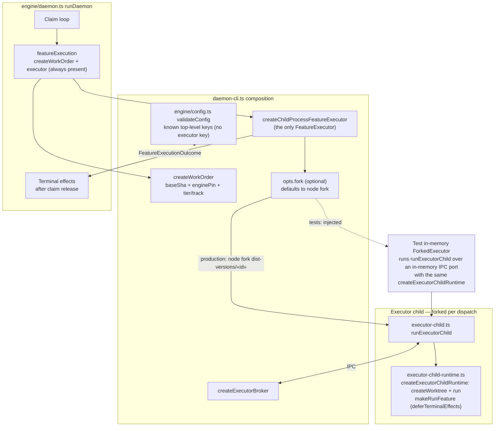
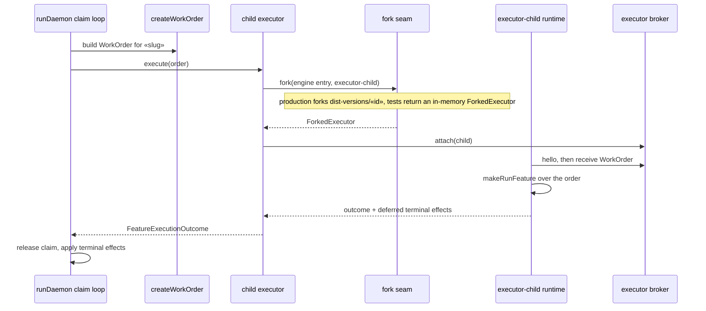

# Architecture: Single daemon feature executor (#3333)

**Last updated:** 2026-10-24
**Scope:** How `daemon-cli.ts` composes feature execution for every dispatch. There is one path:
work order → per-dispatch engine-pinned child executor → executor broker → terminal effects. The
only composition seam is the child executor's process `fork`, which tests replace with an in-memory
fork that runs the real `executor-child` runtime. Builds on
[per-dispatch engine pinning](engine-updates-reach-dispatched-features-only-afte.md).

## Components (L3)

## Sequence: one dispatch (production and test share every step but the fork)

## Legend

- **One executor.** `daemon-cli.ts` builds exactly one `FeatureExecutor`, the child-process
  executor, and always passes `featureExecution` to `runDaemon`. No config value selects another
  execution path. The supervisor always wires `stopAll` and the broker abort into shutdown.
- **Config.** The top-level key set has no executor-selection key. A config that names one fails
  validation with the generic unknown-top-level-key error, like any other unknown key.
- **Fork seam.** The `fork` dependency of `createChildProcessFeatureExecutor`, surfaced as an
  optional daemon-cli option, is the only test boundary for feature execution. It replaces the
  former `opts.runFeature` bypass, so composition, integration, and acceptance tests run the
  production work-order, broker, and terminal-effect path. Only the OS process creation differs.
  The `executor-child` entry point and the test fork build the child's `createWorktree` and `run`
  from one factory, `createExecutorChildRuntime`, so the child composition is identical.
- **Unchanged.** The child's IPC protocol, broker services, engine pinning, executor records, and
  GC protection behave as in the per-dispatch engine pinning architecture.

## Change Log

| Date | Change | Reason |
|------|--------|--------|
| 2026-10-24 | Initial generation | #3333: one feature-execution path; the fork seam replaces the runFeature test bypass |
| 2026-10-24 | Plan update: the child runtime composition becomes one factory shared by the `executor-child` entry and the test fork | #3333 plan Task 1 |
