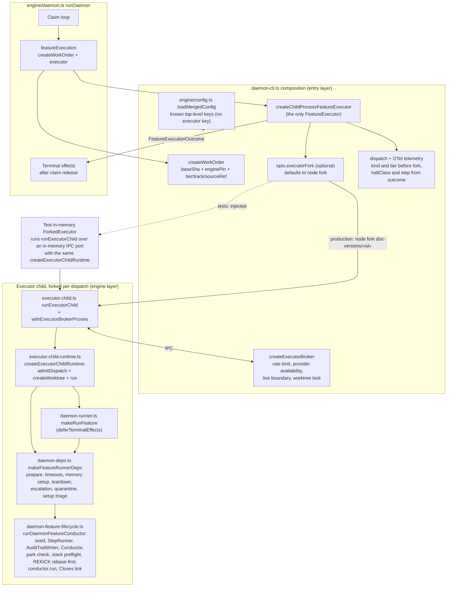
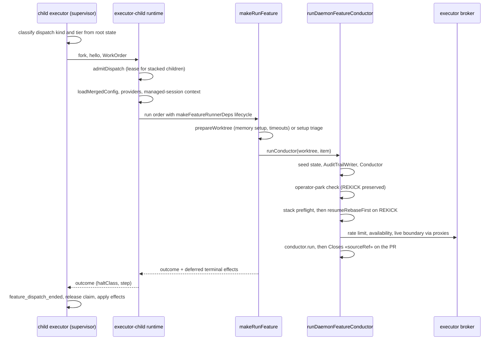

# Architecture: One daemon feature lifecycle, run only in the child executor (#3333)

**Last updated:** 2026-11-07
**Scope:** How the daemon runs one dispatched feature. There is one feature lifecycle, held in
`engine/daemon-feature-lifecycle.ts`, and one place it runs: the per-dispatch engine-pinned child
executor. Slice 1 moves the lifecycle that `runConductorInWorktree` holds in `daemon-cli.ts` into
that module and makes the child run it. Slice 2 removes the in-process executor and the
`executor_isolation` key. The only composition seam is the child executor's process `fork`, which
tests replace with an in-memory fork that runs the real `executor-child` runtime. Builds on
[per-dispatch engine pinning](engine-updates-reach-dispatched-features-only-afte.md).

## Components (L3), after slice 2

## Sequence: one dispatch inside the child

## Legend

- **One lifecycle.** `engine/daemon-feature-lifecycle.ts` holds the body of today's
  `runConductorInWorktree` and the helpers it needs from `daemon-cli.ts`. Supervisor-owned services
  reach it through an explicit context: in the child they are broker proxies. Slice 1 makes both
  adapters call it, and slice 2 deletes the in-process adapter.
- **Layering.** The lifecycle and the child runtime are engine-layer modules. Helpers they need
  that live in `daemon-cli.ts` today, such as `createWorkOrderGitRunner` and the managed-session
  context preparation, move into engine modules, so no engine module imports the entry layer.
- **One executor.** After slice 2, `daemon-cli.ts` builds exactly one `FeatureExecutor`, the
  child-process executor, and always passes `featureExecution` to `runDaemon`. No config value
  selects another execution path.
- **Config.** After slice 2, the top-level key set has no executor-selection key. A config that
  names one fails validation with the generic unknown-top-level-key error.
- **Fork seam.** The `fork` dependency of `createChildProcessFeatureExecutor`, surfaced as an
  optional daemon-cli option, is the only test boundary for feature execution. The test fork gives
  each in-memory child its own console sink, because one test process cannot hold two
  process-global console tees.
- **Telemetry.** The supervisor still owns `feature_dispatch_started` and `feature_dispatch_ended`
  (adr-2026-10-15 D4). It fills them from root state before the fork and from the outcome after it.

## Change Log

| Date | Change | Reason |
|------|--------|--------|
| 2026-10-24 | Initial generation | #3333: one feature-execution path; the fork seam replaces the runFeature test bypass |
| 2026-10-24 | Plan update: the child runtime composition becomes one factory shared by the `executor-child` entry and the test fork | #3333 plan Task 1 |
| 2026-11-07 | The daemon feature lifecycle moves into an engine module run by the child; two-slice delivery | #3333 scope expanded to parity by operator decision |
