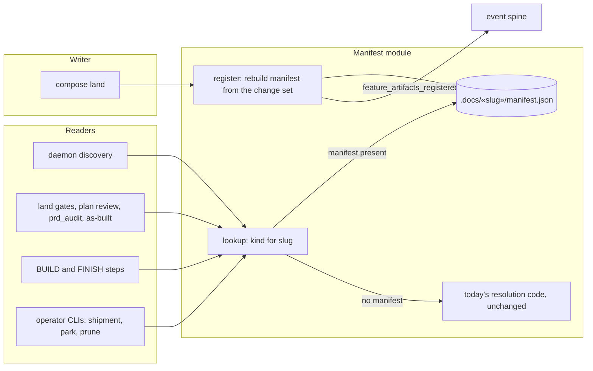

# Components: feature artifact manifest and lookup (#3405, spec 1 of 3)

**Last updated:** 2026-10-24
**Scope:** Proposed structure for spec 1. Every feature gets a committed manifest at
`.docs/«slug»/manifest.json` listing its artifact files. Engine code finds a feature's artifacts
through one lookup, which reads the manifest when one exists and otherwise runs today's
resolution code unchanged. Composer land is the only writer. No artifact file moves in this spec.
Drift checks and protecting the manifest file are spec 2.

## Diagram

## Legend

- **Slug**: the feature's plan stem. For new specs land already requires the plan stem, the
  spec-branch slug and the other artifact stems to match exactly, so every reader's existing key
  finds the manifest. Today's differing keys and `slugify` functions are left as they are.
- **Manifest**: durable state (event-spine exception C), read by name as the authority on which
  files belong to a feature. It holds a schema version, the slug, and `{kind, path}` entries. A
  kind may repeat (several ADRs). ADRs are listed by reference to `.docs/decisions/`. No
  timestamps or history.
- **Register**: the manifest module is the only writer and renders deterministic bytes. Land
  rebuilds the manifest from its change set before staging `.docs` and emits
  `feature_artifacts_registered` on the existing spine. Reseal cannot add files (it refuses paths
  absent from the seal), so it registers nothing.
- **Not in the manifest**: halted and shipped records (repository-wide indexes, like ADRs), release
  waivers (found by the release gate's diff scan), and plan-review records (never committed).
  BUILD's remediation append only edits the already-listed plan, so it registers nothing.
- **Interactive `conduct`**: writes no manifest in this spec and resolves exactly as today. Spec 3
  adds it.
- **Lookup**: given a slug and a feature-scoped kind, returns the file or files. With a manifest it
  reads only the manifest. Repository-wide reads (the ADR and architecture corpora) and plan-review
  records resolve as today. Without one it runs the caller's existing resolution code unchanged, so specs
  from before this change, and consumer repositories, resolve exactly as today. Legacy resolution
  is not reworked, because the manifest replaces it for every new spec.
- **Daemon discovery**: candidates are manifests plus today's `.docs/plans/` files, de-duplicated
  by slug. Shipped, processed and parked checks run before a manifest is parsed.
- **Not in scope here**: path policy (seal, hooks, write allowlist, rebase, retention), drift
  checks and protecting the manifest file stay with spec 2. That is safe because no file moves in this spec.

## Change Log

| Date | Change | Reason |
|------|--------|--------|
| 2026-10-24 | Initial generation | #3405 spec 1: one lookup and a manifest before any layout change |
