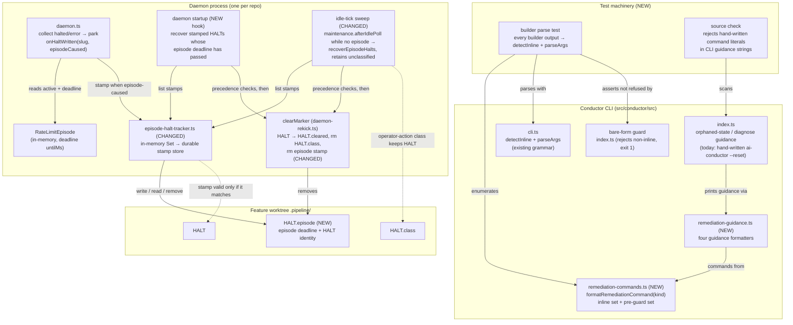
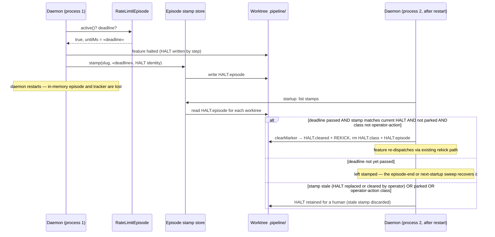

# Components & Sequences: Accepted remediation commands and durable episode-HALT stamps

**Last updated:** 2026-10-10
**Scope:** (1) The conductor CLI's printed remediation commands, routed through one builder whose
outputs are proven to parse by the CLI's own grammar. (2) Episode-caused HALT recovery made durable
across a daemon restart via a per-worktree stamp. Source: jstoup111/ai-conductor#1023.

## Component Diagram (L3)

## Sequence: episode-caused HALT survives a daemon restart

## Legend

- **NEW** / **CHANGED** mark code introduced or modified by this feature; all other nodes exist today.
- `HALT.episode` is durable **state** ("this HALT was caused by a rate-limit episode ending at
  «deadline»"), not an occurrence — event-spine exception C, the same category as `HALT.class`. The
  existing `loop_halt` / park events on `events.jsonl` are unchanged.
- **HALT identity** binds a stamp to the specific HALT it was written for, so a stamp left behind
  after an operator `rm -f .pipeline/HALT` can never clear a later, human-caused HALT.
- Precedence is unchanged from today's sweep: operator park and operator-action HALT classes
  outrank automatic recovery.
- The source check covers the CLI guidance strings the operator is told to run; the parse test is
  the proof that each builder output is accepted rather than refused by the bare-form guard.
- `«deadline»` is a runtime value, not a literal.

## Change Log

| Date | Change | Reason |
|------|--------|--------|
| 2026-10-10 | Plan update: guidance module, idle-tick trigger, unclassified retention | /plan for #1023 |
| 2026-10-10 | Initial generation | Feature design for #1023 (remediation-command builder, durable episode-HALT stamp) |
