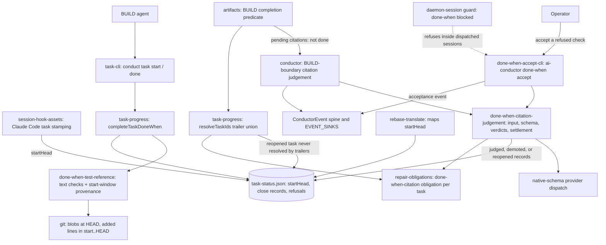

# Components: Done-when `[test]` citations proven by provenance or judgement

**Last updated:** 2026-10-21
**Scope:** Engine components touched by #3200 and how they connect. The runtime flow is in [the sequence diagram](sequences/done-when-closes-as-verified-citing-tests-that-don.md).

## Diagram

## Legend

New: the task start HEAD recorded by `conduct task start`; a start-window provenance check inside `done-when-test-reference`; a pending-judgement close record and a judged close source; a pure `citation-judgement` module (prompt, native output schema `asserts | does-not-assert` with a reason, verdict application); the conductor's BUILD-boundary dispatch; a per-check refusal count with a hard bound; the operator-only `ai-conductor done-when accept` command and its durable acceptance record; citation-judgement events on the existing spine. Changed: `completeTaskDoneWhen` stamps `verified` only for a test title added in the task's start→close window and pending otherwise; the BUILD completion predicate is not done while a citation is pending; trailer resolution excludes a task reopened by a refusal. Unchanged: the `Task:` trailer stamping (telemetry, adr-2026-07-21), `--unverified`, `prd_audit`, `build_review`, halt classes. `adr-2026-08-22-done-when-evidence-at-task-close` as amended by #3200 governs.

## Change Log

| Date | Change | Reason |
|------|--------|--------|
| 2026-10-21 | Initial component view | #3200: `[test]` checks closed verified citing tests that don't assert the check |
| 2026-10-21 | Plan update: session hook, rebase translation, obligation store, accept CLI, guard | /plan for #3200 |
