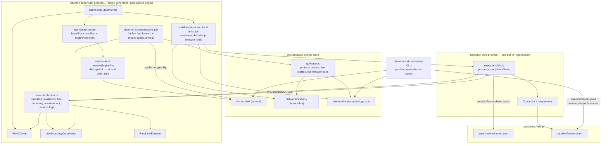
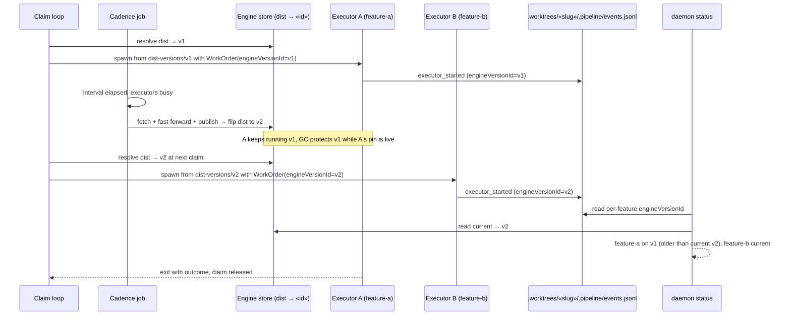

# Architecture: Per-dispatch engine pinning (#2392)

**Last updated:** 2026-10-15
**Scope:** The daemon supervisor/dispatcher, the process-separated feature executor pinned to one
`dist-versions/«id»`, the cadence fetch+rebuild job, engine-store GC protection, and per-feature
engine-version telemetry and status. Self-host and consumer daemons share the dispatch path; the
cadence rebuild applies where the daemon already owns engine rebuilds (self-host).

## Components (L3)

## Sequence: rebuild lands while a feature is in flight

## Legend

- **Supervisor** stays a single generation (adr-2026-07-07 D1). It still runs its boot-pinned
  engine; a drained self-restart remains only for changes to the supervisor/dispatcher code itself,
  never as the path by which features adopt a new engine.
- **Engine pin resolver** turns the floating `dist` symlink into a concrete immutable version id at
  claim time; that id travels in the WorkOrder beside `baseSha`. The supervisor sends the
  serialized order over IPC after an accepted hello; the child persists it to
  `.pipeline/work-order.json` once the worktree exists.
- **Executor child** is spawned from `dist-versions/«id»` directly (not through the `dist` symlink),
  so a later flip cannot change the engine under a running feature. The pin lasts one dispatch:
  a halted or parked feature re-dispatched later resolves the current build again.
- **Executor records** (`.daemon/executors/«slug».json`, written by the supervisor) name each
  live child's pid and engine dir; GC and `daemon status` read them.
- **IPC channel / broker**: dispatcher-owned shared services (rate-limit episode, live-boundary
  fingerprint windows, claim release) stay in the supervisor; the executor reaches them over a
  versioned message channel rather than shared memory.
- **Cadence job** runs only in a self-host daemon with the stale-engine gates armed, as background
  maintenance while executors are busy; root mutations are
  serialized against open live-boundary windows by the existing `LiveBoundaryCoordinator`.
- **GC** adds live executor pins to its protected set, fail-closed like the pidfile check.
- **Telemetry** uses the existing event spine: the executor stamps its engine version id onto a
  `ConductorEvent` in the feature's own `events.jsonl`; no sidecar file.

## Change Log

| Date | Change | Reason |
|------|--------|--------|
| 2026-10-15 | Initial generation | #2392 per-dispatch engine pinning |
