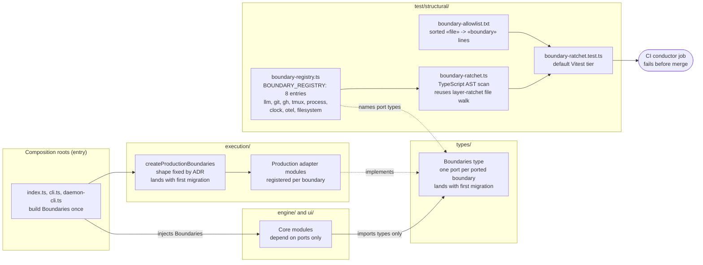
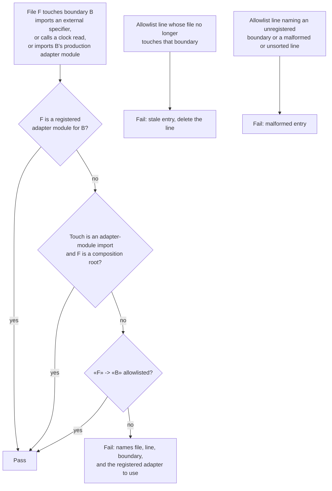

# Components: External-boundary registry and ratchet (#1989)

**Last updated:** 2026-11-07
**Scope:** The ports-and-adapters convention for external boundaries in `src/conductor/src/`, covering
one enumerable boundary registry and a default-tier, shrink-only boundary ratchet. Plan stem:
`external-boundaries-have-no-swappable-seams-rerout`. No call sites migrate in this spec. Root
construction of `Boundaries` lands with the first migration (#3043, git).

## Diagram

### Components

### Ratchet verdict for each external touch

## Legend

- A solid arrow is a data or construction dependency. `-.->|implements|` means the adapter satisfies
  the port type. "imports types only" means a type-only import of the port.
- **Boundary registry.** `BOUNDARY_REGISTRY` is the one enumerable list of external boundaries. Each
  entry carries its name, port type name (or `pending`), production adapter module paths,
  external module specifiers (for example `node:child_process`, `execa`, `node:fs`,
  `node:fs/promises`, `@opentelemetry/*`, `chokidar`), call patterns (clock: `Date.now()`,
  zero-argument `new Date()`, `performance.now()`), and its migration status (`ported`, or
  `pending #N`). It lives in `test/structural/` beside the layer ratchet's layer definitions,
  because the ratchet is its only reader. A production module read only by a test would be an
  unreachable rung at the SHIP as-built sweep.
- **Touch.** Any of these:
  - a static or dynamic import of an external specifier (both `node:x` and bare `x` forms);
  - a clock-read call expression;
  - a `git`, `gh` or `tmux` string-literal first argument to a spawn callee;
  - a value import of a registered production adapter module.

  Type-only imports are not touches.
- **Composition roots.** These are the entry-layer files of the #1988 layer ratchet. Only they may import
  production adapter modules. This spec adds no root construction yet.
- **Scan scope.** `src/conductor/src/**/*.ts`, the same file set as the layer ratchet. Tests are out of
  scope.
- The allowlist only shrinks. It is seeded with every existing touch at land time (roughly 350
  `«file» -> «boundary»` lines, most of them filesystem), and it shrinks as each per-boundary
  migration lands.

## Change Log

| Date | Change | Reason |
|------|--------|--------|
| 2026-11-07 | Initial generation | DECIDE for #1989 |
| 2026-11-07 | Registry moved from `types/` to `test/structural/` | Architecture review: its only reader is the ratchet |
