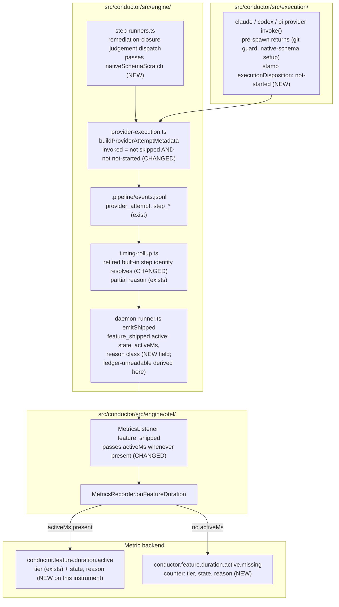

# Components: Measured feature active duration always reaches OTEL

**Last updated:** 2026-10-26
**Scope:** The path from a provider attempt to the `conductor.feature.duration.active` data point:
provider adapters → attempt metadata → per-feature `.pipeline/events.jsonl` → timing rollup →
`feature_shipped` → `MetricsListener` → `MetricsRecorder`. Plus the remediation-closure judgement
dispatch's native-schema scratch input. No new component, event variant, or ledger.

## Diagram

## Legend

- **NEW / CHANGED** mark what this spec adds or alters; everything else exists on main.
- `state` is `exact`, `partial`, or `unavailable`. `reason` is a closed class set: `empty-active-union`, `active-evidence-incomplete`,
  `open-executions` (execution keys never become labels), `provider-outside-active-union`,
  `provider-evidence-incomplete`, `ledger-unreadable`. It is absent when the state is `exact`. Both reuse label names already in ADR-014's closed vocabulary.
- `activeMs` is present only when the active union is complete: state `exact`, or `partial`
  solely because the provider partition is incomplete. Every other `partial` and `unavailable`
  rollup carries no `activeMs` and increments the missing counter instead.

## Change Log

| Date | Change | Reason |
|------|--------|--------|
| 2026-10-26 | Initial generation | Spec: feature active duration is dropped from OTEL whenever the timing rollup is partial |
| 2026-10-26 | ledger-unreadable derived at the feature_shipped emit site | Conflict check: shipped-record Time block stays unchanged |
