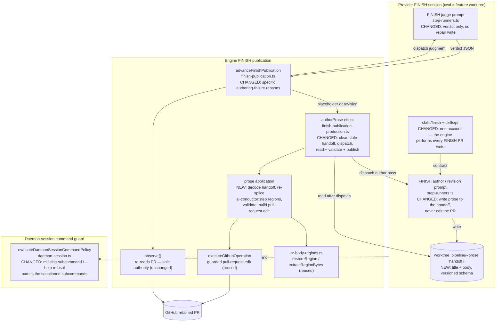
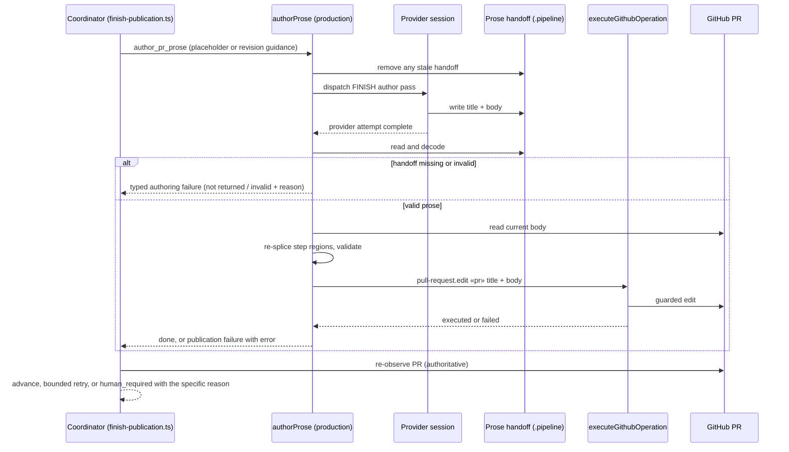

# Components: The Engine Owns FINISH's PR-Prose Write (#3529)

**Last updated:** 2026-10-31
**Scope:** The FINISH publication path from the coordinator's `author_pr_prose` decision, through
the provider's authoring pass, to the retained pull request's title and body. It covers the
coordinator (`finish-publication.ts` `advanceFinishPublication`, author branch and disposition
reasons), the production authoring effect (`finish-publication-production.ts` `authorProse`), the
conductor's FINISH dispatch (`conductor.ts` `runFinishPublication`, `restoreCapturedRegions`,
`resolveShipDraftPublicationDependencies`), the FINISH prompt blocks (`step-runners.ts`), the
`skills/finish` and `skills/pr` contracts, the PR-body region helpers (`pr-body-regions.ts`), the
guarded operation executor (`github-operations.ts` `executeGithubOperation`), and the
daemon-session command guard (`execution/daemon-session.ts`). Transport (`tracker-client.ts`) and
the `github-operation` CLI are unchanged.

## Diagram

## Legend

- **NEW** marks a component or artifact this change adds; **CHANGED** marks existing behavior this
  change alters; **reused** marks an existing seam called from a new place; unmarked nodes exist
  today and are unchanged.
- `«prose handoff»` is `.pipeline/finish-pr-prose.json`, shaped `{"version":1,"title":…,"body":…}`
  (adr-2026-10-31-engine-performs-finish-pr-prose-write D1). It is decoded and applied by the new
  `finish-pr-prose-handoff.ts` module (`readPrProseHandoff`, `clearPrProseHandoff`,
  `applyAuthoredPrProse`).
- Solid arrows are calls or writes; dotted arrows are contracts or policy that apply to the
  provider session.
- Re-observation stays the only authority on whether `pr.prose` moved: a successful edit never
  advances the transition by itself.

## Change Log

| Date | Change | Reason |
|------|--------|--------|
| 2026-10-31 | Initial generation | #3529: move FINISH's PR title/body write from the provider to the engine |
| 2026-10-31 | Plan update: name the handoff path and the `finish-pr-prose-handoff.ts` module | Plan for #3529 fixed the handoff schema and module |
