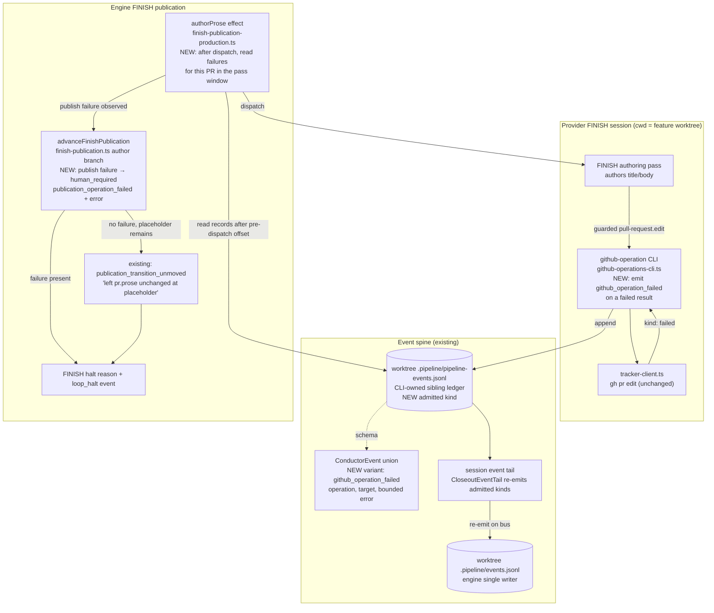
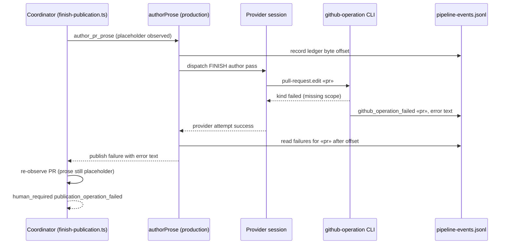

# Components: FINISH Reports the Real PR-Publish Failure (#3376)

**Last updated:** 2026-10-24
**Scope:** The path from a provider-run guarded GitHub write during FINISH's `author_pr_prose`
pass to the FINISH halt disposition — the `github-operation` CLI
(`github-operations-cli.ts`, launched by the provider with the feature worktree as cwd), the
single-writer sibling ledger (`.pipeline/pipeline-events.jsonl`) and the session event tail
(`CloseoutEventTail`) that re-emits admitted kinds onto the bus, the production authoring effect (`finish-publication-production.ts`
`authorProse`), and the publication coordinator (`finish-publication.ts` `advanceFinishPublication`
author branch and `HUMAN_REQUIRED_REASONS`). Transport (`tracker-client.ts` `gh pr edit`) is
unchanged and out of scope.

## Diagram

## Legend

- **NEW** marks behavior this change adds; unmarked nodes exist today.
- `«pr»` is the feature's pull-request target (repository + number).
- The pass window is the sibling ledger's byte length recorded before dispatch; only
  `pull-request.edit` failures for the feature's own PR target appended after it count.
- The CLI never writes the engine-owned `events.jsonl` for this event (adr-2026-08-08 D2); the
  session tail re-emits it there.
- Re-observation stays authoritative: if the PR prose moved despite a recorded failure (e.g. a later
  retry succeeded), the transition advances normally.

## Change Log

| Date | Change | Reason |
|------|--------|--------|
| 2026-10-24 | Initial generation | Spec for jstoup111/ai-conductor#3376 |
| 2026-10-24 | Route the event through the sibling ledger and tail | Architecture review: one writer per ledger |
| 2026-10-24 | Plan update: no structural change; the diagram matches plan Tasks 1–6 | /plan step 8b |
