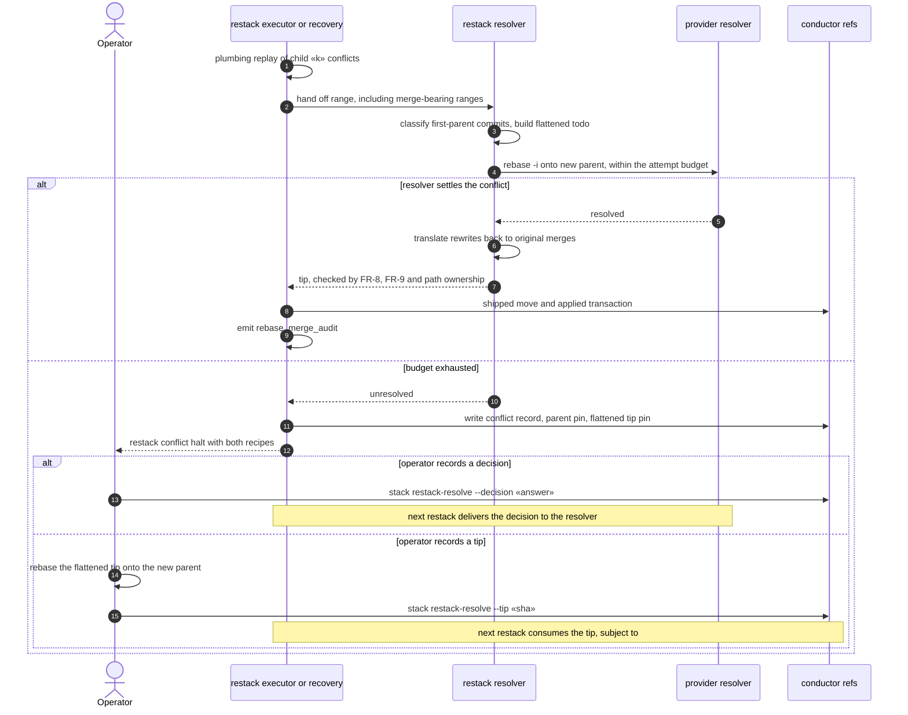

# Sequence: Stacked restacks recover merge-bearing conflicts automatically (#3438)

**Last updated:** 2026-11-01
**Scope:** the stacked restack conflict path in `runRestack` and `resumePlanned` when the child's own range contains a merge. N=1 `flatten_refused` rebases are out of scope.

**What changes:**
- **No refusal.** A merge-bearing replay conflict no longer halts `flatten_refused`. It takes the shipped decision delivery and resolver path.
- **Flatten at hand-off.** The resolver's todo walks the first-parent range and classifies each merge with `classifyReplayMerge`, as the plumbing replay does: ancestry-only merges are dropped, a Q-carried merge contributes only its hand-resolved part, any other merge becomes one flattened commit carrying its change from its first parent, and a flattened commit whose change the new parent already contains is dropped, as the plumbing replay drops it.
- **Rewrites and audit.** The rewritten list is translated from flattened commits back to the original merges, and `rebase_merge_audit` also covers a resolved child.
- **On exhaustion.** The ordinary restack conflict halt is written. Its `--tip` recipe starts from a pinned linear flattened tip instead of the merge-bearing `oldTip`, because a plain rebase of the merge-bearing tip drops the merge's hand edits and subject. `--decision` is unchanged.

**Built on shipped code:** `replayChildRange`, `classifyReplayMerge`, `resolveRestackConflict`, `prepareRestackDecisionDelivery`, `haltRecordedRestackConflict`, `writeConflictRecord`, `consumeRecordedResolution`, `appliedTransactionLines`, and `featureConductorRefNames`.

## Diagram

## Legend

- **Flattened tip pin:** `refs/conductor/«slug»/restack/conflict/flattened-tip`. It is written only for a merge-bearing child, and has the same lifecycle as `conflict/parent`.
- **Children with no merge in their range:** every step is unchanged, and no flattened tip pin is written.

## Change Log

| Date | Change | Reason |
|------|------|------|
| 2026-11-01 | Initial sequence | #3438 |
