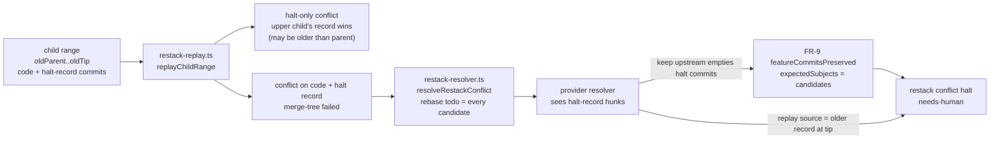
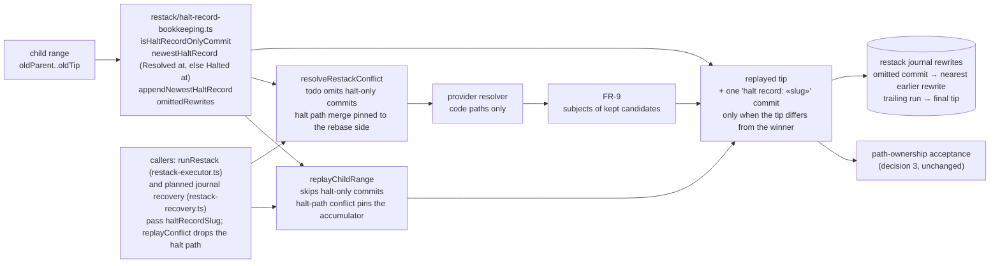
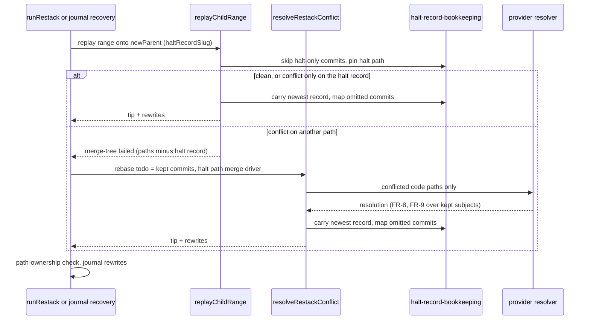

# Components: Halt-record bookkeeping in stacked restack replay

**Last updated:** 2026-10-28
**Scope:** How a stacked restack replays a child range that carries halt-record commits
(`.docs/halted/«slug».md`), on both replay paths, before and after this change (intake #3451).
Halt records are still committed on the active child branch (build-region decision 11), and flat
features keep `performRebase`.

## Diagram

### Before (halt-record commits are ordinary replay candidates)

### After (halt-record commits are bookkeeping)

### One child replay with halt-record bookkeeping

## Legend

- **Halt-only commit:** a non-merge commit whose changed paths are exactly `.docs/halted/«slug».md`.
  Apart from excluding merges, it is the predicate child-cursor, operator-round, restack-plan and
  restack-recovery already use.
- **Kept commit:** every other commit in the range, replayed under the existing rules of decision 3:
  patch-equivalent skipping, empty-commit handling, merges.
- **Newest record:** the tip must carry the winner. When the range never touched the record, the
  winner is the new parent's record. Otherwise it is the newer of the new parent's record and the
  range's old-tip record, by `Resolved at:` (or `Halted at:` when unresolved). A tie, or neither
  side parsing, picks the new parent's; when only one side parses, that side wins. One
  `halt record: «slug»` commit (no trailer, journal stamp) sets the winner when the tip differs.
- **Pinned halt path:** in a kept commit that also edits the halt record, the replayed tree takes
  the accumulator's record. The tip's bookkeeping commit then sets the newest record.

## Change Log

| Date | Change | Reason |
|------|--------|--------|
| 2026-10-28 | Initial generation | #3451: halt-record commits make stacked restacks conflict |
| 2026-10-28 | Plan update: both callers (runRestack and journal recovery) and bookkeeping inside replayChildRange and resolveRestackConflict | /plan found recovery re-runs both replay paths |
