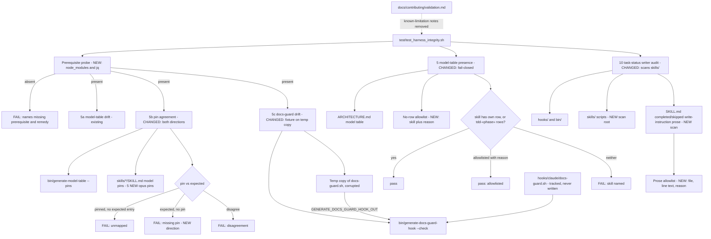

# Components: Integrity suite check hardening (#1014)

**Last updated:** 2026-10-14
**Scope:** Checks 5, 5a, 5b, 5c, and 10 of `test/test_harness_integrity.sh` and the files they read.
Every changed check either enforces (counts toward the failed total and exit code) or is exempted
by a named entry carrying a reason. Check 4, check 1b, and every other check are unchanged.

## Diagram

## Legend

- **NEW / CHANGED** mark what this feature adds or alters; unmarked nodes already exist on `main`.
- **Checker scripts:** per the plan, checks 5, 5b, 5c's fixture, 10, and the prerequisite probe each
  live in a standalone `test/check_*.sh` with `HARNESS_INTEGRITY_*` seams plus a `test/test_*.sh`
  fixture spec, invoked by the suite (check 22's pattern) and registered in `test/shell_tests.manifest`.
- **Prerequisite probe** replaces the per-check WARN-skips in 5a/5b/5c: a missing
  `src/conductor/node_modules` (or `jq` for 5b) is a counted failure, not a warning.
- **No-row allowlist** mirrors check 4's `KNOWN_NON_SKILL_REFS`: each entry names a skill that
  deliberately has no model-table row and states why. `tdd` needs no entry — its `tdd-«phase»`
  rows satisfy it.
- **Temp copy:** check 5c's drift-detection fixture writes only a `mktemp` file and points the
  generator at it through the existing `GENERATE_DOCS_GUARD_HOOK_OUT` seam; the tracked hook is
  read, never written, so an interrupt cannot corrupt it.
- **Write-instruction prose scan:** flags a SKILL.md line that directs an agent to write an
  engine-only status (`completed` or `skipped`) to `.pipeline/task-status.json`. Advisory
  `pending`/`in_progress` scheduling writes stay legal (`adr-2026-07-05-engine-owned-task-status`
  D4); descriptive and read-only lines pass; any residual false positive needs a reasoned
  allowlist entry.

## Change Log

| Date | Change | Reason |
|------|--------|--------|
| 2026-10-14 | Initial generation | #1014 integrity suite hardening |
