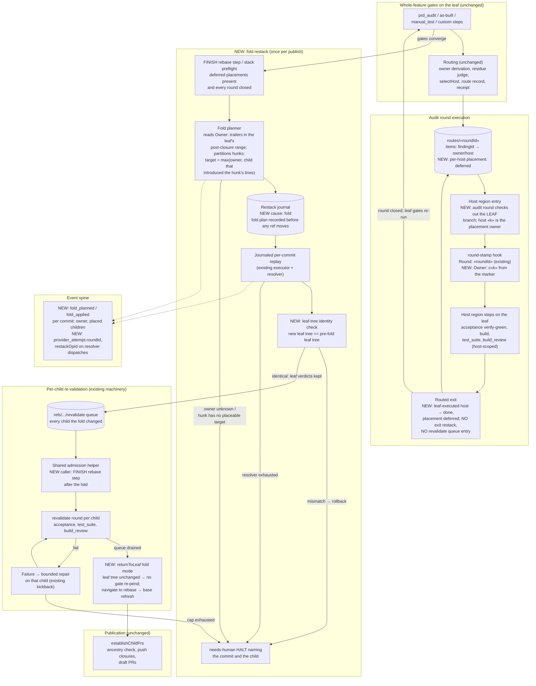
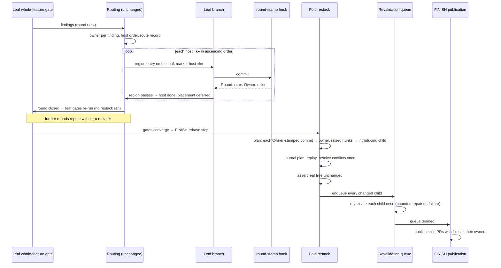

# Components: Routed Audit Fixes Run on the Leaf and Fold onto Their Owners Once Before Publish (#3653)

**Last updated:** 2026-11-08
**Scope:** How a stacked feature's whole-feature audit round (`prd_audit`,
`architecture_review_as_built`, `manual_test`, post-region custom steps) places routed fixes
without restacking the children above each host every round, and how those fixes reach the PR of
their owning child once, before publication. Covers the audit host's region entry and routed exit
(`routing/host-region-entry.ts`, `routing/routed-exit.ts`, `routing/round-admission.ts`), the
commit-hook round stamp (`round-stamp-cli.ts`, `git-hook-assets.ts`), a new `fold` restack cause
(`restack/restack-plan.ts`, `restack/restack-executor.ts`, `restack/restack-transition.ts`), the
existing revalidation queue (`routing/revalidation-queue.ts`), the FINISH `rebase` step and
publication (`finish-publication-production.ts`), and the event spine (`types/events.ts`).
Operator rounds (`stack land`, closed-child `rewind`) and `revalidate` rounds keep today's
owner-branch execution.

## Diagram

## Sequence: one audit round, then the fold

## Legend

- **Owner** is the child routing names for a finding (unchanged authority). **Host** is today's
  executing child; for an audit round it becomes the placement owner, while execution happens on
  the leaf.
- **Owner floor:** a fix never lands below its routed owner. A hunk moves above the owner only
  when the lines it edits were introduced by a higher child, so they do not exist at the owner.
- **Leaf-tree identity:** the fold may only redistribute commits; the leaf's final tree must equal
  its pre-fold tree, so the whole-feature verdicts already earned on the leaf stay valid.
- `NEW:` marks behaviour this feature adds; unmarked boxes are existing machinery.
- `«…»` are placeholders.

## Change Log

| Date | Change | Reason |
|------|--------|--------|
| 2026-11-08 | Initial generation | #3653: defer routed audit-fix placement to one fold before publish |
| 2026-11-08 | Added rebase-step queue admission and fold-mode leaf return | Architecture review: the rebase step does not read the queue today, and `returnToLeaf` re-pends unconditionally |
