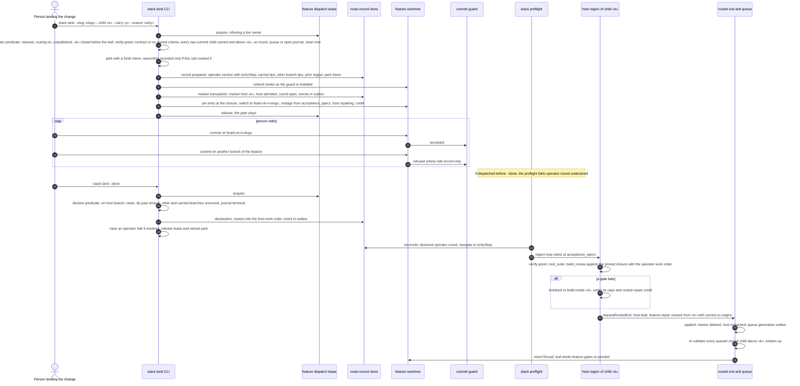
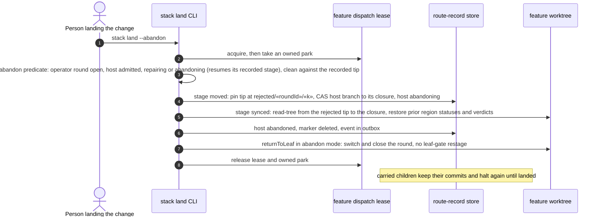
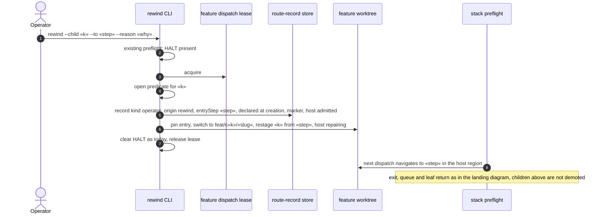
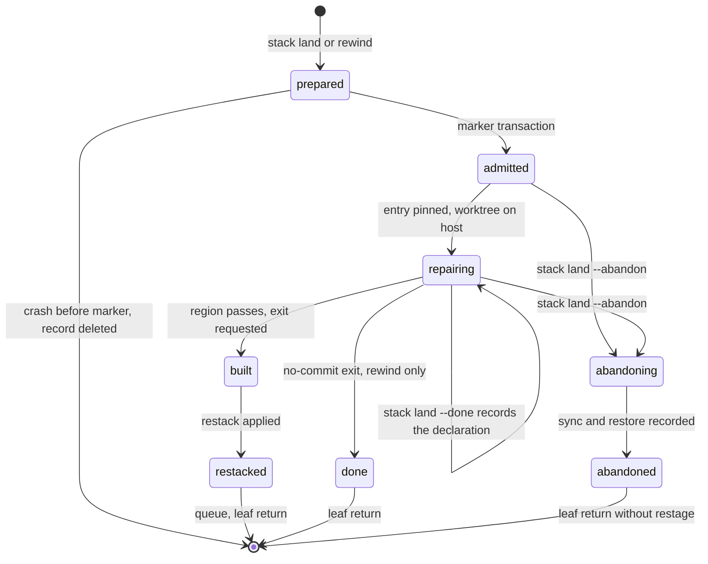
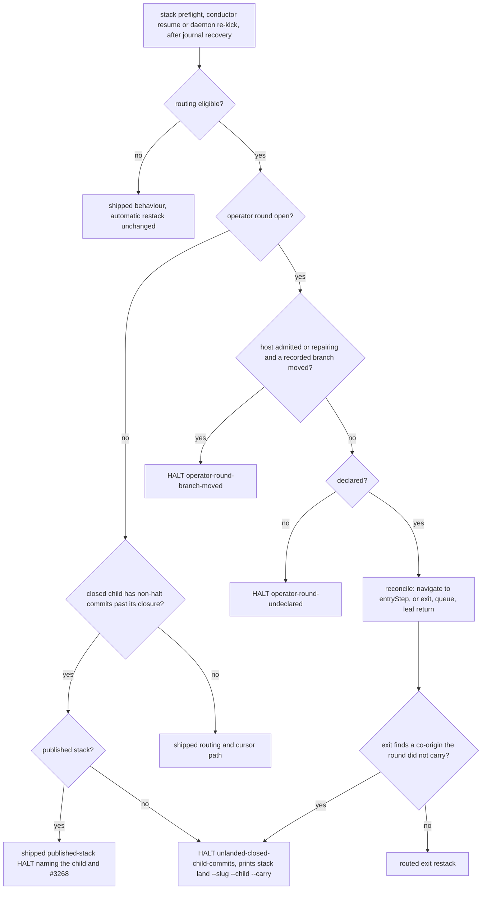
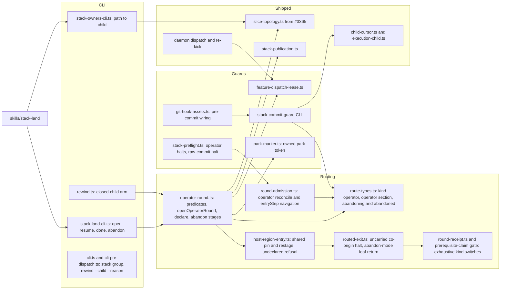

# Sequence + Components: Land manual changes in the stacked child that owns them, and rewind closed children (#3203)

**Last updated:** 2026-10-24
**Scope:** the operator route round of `adr-2026-10-24-operator-route-round-for-closed-stacked-children`.
It is a third route kind on the routed-repair machinery of `adr-2026-10-12-routed-whole-feature-repair`,
with origin `land` or `rewind`:
- a durable feature dispatch lease excludes the daemon and every other writer while an operator
  command mutates the feature;
- `ai-conductor stack land --child «k» [--carry «j»…]` opens a round on a closed child. It checks
  mechanical preconditions first. It then parks the feature with an owned token, installs the commit
  guard, and switches the worktree to that child's branch;
- while any round is open, the commit guard refuses commits on every branch but the host;
- the preflight halts on three things: an undeclared round, a moved branch, and a closed-child
  commit no round carried. With routing on, automatic co-origins and the automatic `feature-repair`
  restack are retired;
- `stack land --done` records the declaration. The daemon then re-validates the child from
  `acceptance_specs` and leaves through the shipped routed exit, re-validation queue and leaf gates;
- `stack land --abandon` resets the host to its closure through recorded stages;
- `rewind --child «k»` on a closed child opens a declared round instead of refusing;
- `ai-conductor stack owners` reports which child introduced each path, so the shipped skill can
  judge the owner.

Published stacks are out of scope: every entry point refuses on an active publication record and
names #3268. Slice topology is read through the #3365 loader (`loadSliceTopology`).

**Built on shipped code:**
- **Route-record store and writer:** `writeRoutingTransaction`, `createRouteRecord`,
  `transitionHost`, `drainRoutingOutboxes`, `nextRoundId`, `routingFenceOpen`.
- **Admission and reconciliation:** the marker transaction of `admitRound`, `reconcileRounds`,
  `routedRoundOpen`.
- **Region entry and exit:** the pin and restage helpers of `enterHostRegion`, `requestRoutedExit`,
  `returnToLeaf`, `consumeLowestQueued`, `grantRoutedRepairCredit`.
- **Cursor and execution child:** `resolveActiveChild`, `resolveExecutionChild`,
  `resolveChildBase` (`routed-repair` base).
- **Guards and leases:** `park-marker.ts`, `publishedStackRefusal`, `createConductStateLease`,
  `isJournalOwnerAlive`, `writeGitHooksAndWire`.

## Diagram: landing a manual change

## Diagram: abandoning a landing

## Diagram: rewinding a closed child

## Diagram: operator host phases

## Diagram: preflight decision

## Diagram: components touched

## Legend

- **Operator round:** a route record of kind `operator`. Origin `land` opens undeclared and waits for
  `--done`; origin `rewind` is declared at creation.
- **Host:** the closed child the round re-opens. The leaf is never an operator host.
- **Carried child:** a closed child above the host whose existing post-closure commits the round
  carries as a co-origin of its exit restack.
- **Declaration:** the person's statement that the change is complete, recorded with the host tip.
  The host stays `repairing`; the declaration is a record field, not a host state.
- **Feature dispatch lease:** a durable per-feature lease with process liveness. Daemon dispatch
  and re-kick hold it for the unit and re-check the park; an interactive conductor run holds it
  without consulting the park; the four new operator commands hold it for their mutation.
- **Commit guard:** a pre-commit step. While any marker exists, it refuses a commit on any branch of
  the feature other than the host, unless every staged path is the halt record. After an operator
  declaration it also refuses host commits outside a daemon session.
- `«k»`, `«j»`, `«slug»`, `«roundId»`, `«step»`: placeholders.

## Change Log

| Date | Change | Reason |
|------|--------|--------|
| 2026-10-24 | Initial generation | #3203 DECIDE |
| 2026-10-24 | Owned park, carrying of raw closed-child commits, recorded branch tips, region entry at acceptance_specs | Operator decisions during architecture review |
| 2026-10-24 | Coherence-judge fixes: tip check before the undeclared check, abandon resumes an `abandoning` host | Coherence check |
| 2026-10-24 | Conflict-check resolutions: publication checked before the unlanded halt, interactive runs take the lease without the park re-check, no cascade check at open, `--adopt` renamed `--carry` | Conflict check |
| 2026-10-24 | Feature dispatch lease, token park, carried co-origins and the uncarried co-origin halt, guard in every round kind, staged abandon, rewind without demoting children above | Adversarial review findings and operator lease decision |
