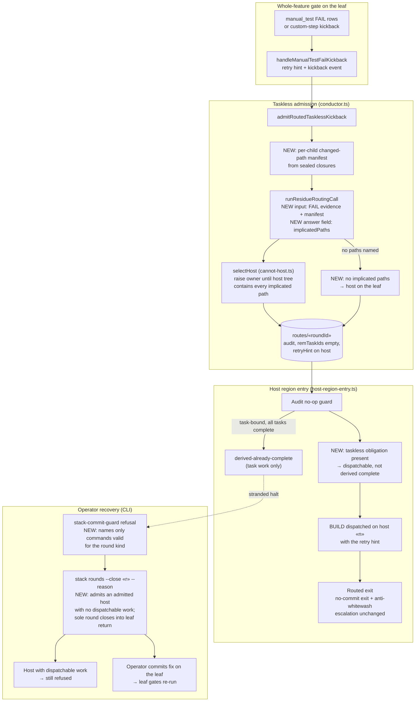

# Components: Taskless Routed Obligations Dispatch on a Host That Can Hold the Fix, and a Stranded Round Can Be Closed (#3605)

**Last updated:** 2026-11-07
**Scope:** How a taskless whole-feature obligation (a `manual_test` FAIL or a post-region
custom-step kickback) is placed on a stack child, how that child's region entry decides whether
there is BUILD work, and how an operator recovers a stranded audit round. Covers
`admitRoutedTasklessKickback` in `conductor.ts`, `runResidueRoutingCall` /
`renderResidueRoutingPrompt` in `routing/residue-routing-call.ts`, `selectHost` in
`routing/cannot-host.ts`, the audit no-op guard in `routing/host-region-entry.ts`,
`checkCloseable` / close in `stack-rounds-cli.ts`, and the refusal text in
`stack-commit-guard-cli.ts`.

## Diagram

## Legend

- **NEW** marks behavior this change adds; unmarked nodes exist today and keep their behavior.
- `«roundId»`, `«n»`, `«r»` are placeholders for a routing round id, a host child position and a
  round id given on the command line.
- Solid arrows are the normal flow; the dotted arrow is the halt an operator recovers from.
- "Leaf" is the last declared slice position (`feat/daemon-«slug»`), whose tree holds every
  child's code.

## Change Log

| Date | Change | Reason |
|------|--------|--------|
| 2026-11-07 | Initial generation | #3605: taskless routed obligation was placed blind and never dispatched; no supported recovery for a stranded sole audit round |
