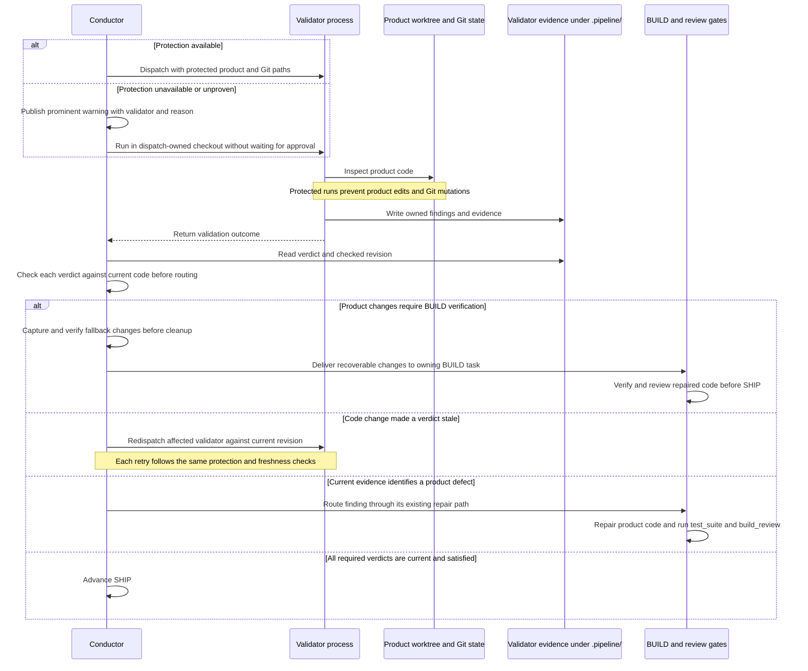

# Protected SHIP validation and stale verdict recovery

**Last updated:** 2026-11-19  
**Scope:** Proposed dispatch and verdict handling for manual_test, prd_audit and architecture_review_as_built in #3685.

The validator lane represents one member, whether dispatched alone or alongside siblings. The conductor owns the parallel join. Each validator needs a writable location for its own evidence. A code change made outside the validator can invalidate a result even when the validator itself obeyed its write restrictions.

The existing gate-code-validity logic distinguishes verdicts that can be preserved from those that require a rerun. The proposed join uses that distinction before consuming findings. Both dispatch modes bind evidence to the revision inspected. The unprotected path must also account for uncommitted product edits before trusting the results.

## Change log

2026-11-19 — Added the proposed validation flow for #3685.
