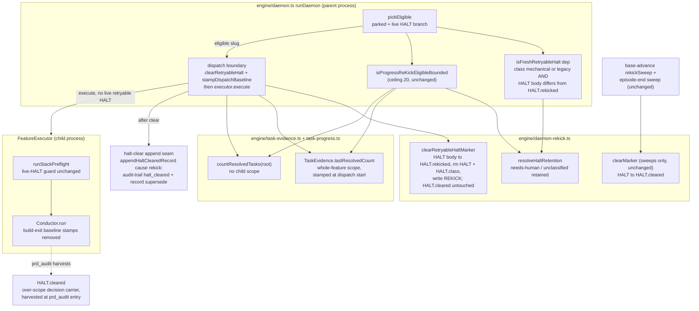
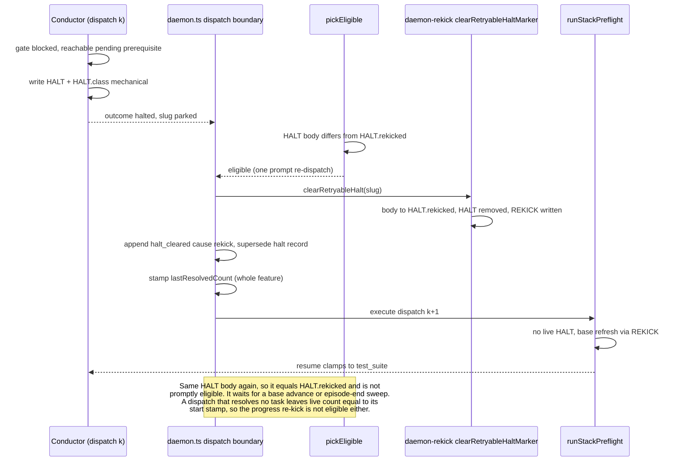

# Architecture: A retryable HALT is cleared before the daemon re-dispatches it (#3601)

**Last updated:** 2026-11-07
**Scope:** How the daemon core re-dispatches a parked feature whose `.pipeline/HALT` is retryable (class `mechanical` or `legacy`). Before this change, the progress-gated re-kick re-dispatched such a feature with its HALT still live. On a stacked feature, the stack preflight refused every one of those dispatches ("live HALT without resume authorization"). The refused dispatch did not move the progress baseline, so the feature stayed eligible and looped until the per-run dispatch ceiling (20). After this change, the daemon core's dispatch boundary owns three things: clearing the retryable HALT, granting one prompt re-dispatch per distinct retryable HALT, and stamping the progress baseline. The stack preflight's live-HALT guard and needs-human retention do not change. The dispatch boundary runs in the parent daemon process, ahead of whichever `FeatureExecutor` runs the feature, so it does not depend on [one daemon feature lifecycle](daemon-still-carries-two-feature-executors-in-proc.md).

## Components (L3)

## Sequence: a mechanical HALT on a stacked feature

## Legend

- **Retryable HALT:** `HALT.class` resolves to `mechanical` or `legacy` through `resolveHaltRetention`. `needs-human`, `unclassified`, and unknown classes are retained. No automatic path in this design clears or re-dispatches them.
- **Distinct HALT:** compared by the bytes of the live HALT body against `.pipeline/HALT.rekicked`, the body the dispatch boundary last cleared. That is per-worktree durable state, read by name (event-spine exception C).
- **`HALT.cleared` is never touched by the dispatch boundary.** It is also the prd_audit over-scope decision carrier (`adr-2026-08-24-over-scope-decision-block-and-durable-refusals`), so overwriting it before prd_audit harvests it would destroy an operator's decision. The sweeps still use `clearMarker`, unchanged; #3551 tracks that file's semantics.
- **Progress baseline:** `TaskEvidence.lastResolvedCount`. Its only reader is the progress-gated re-kick. After this change, the dispatch boundary is its only writer, at whole-feature scope.
- **Unchanged:** the stack preflight's live-HALT guard and its resume-authorization path, the base-advance sweep's once-per-SHA bound, the episode-end sweep, the operator park, and the progress re-kick ceiling.

## Change Log

| Date | Change | Reason |
|------|--------|--------|
| 2026-11-07 | Initial | #3601 resume-and-refuse loop on mechanical HALTs |
