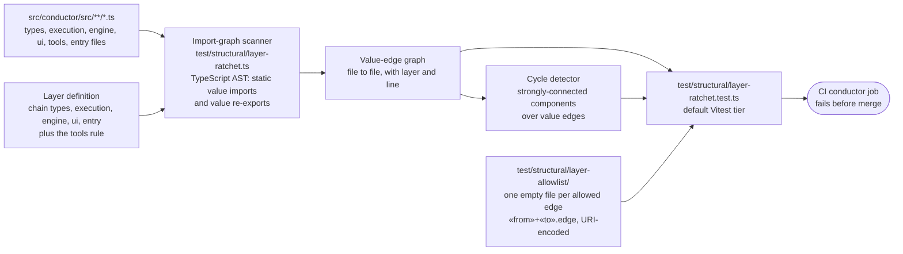
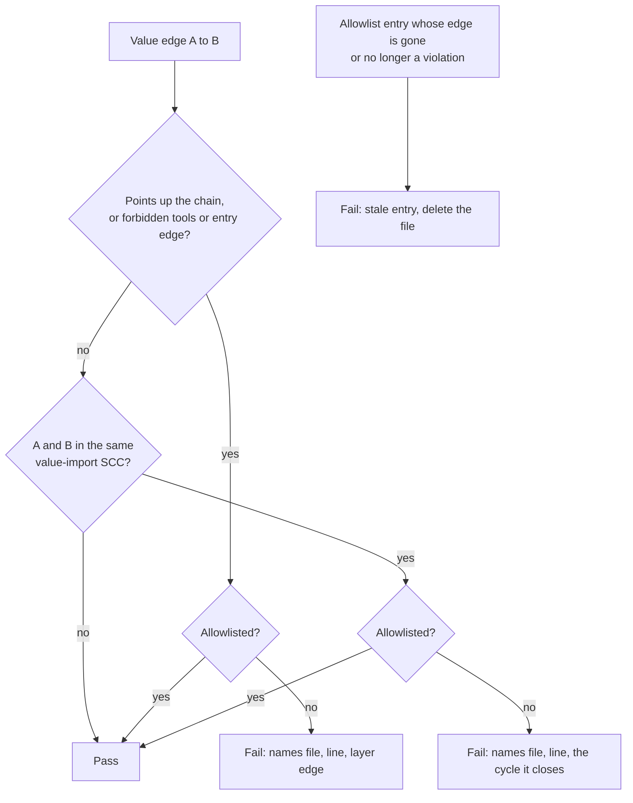

# Components: Import-graph layer ratchet (#1988)

**Last updated:** 2026-10-24
**Scope:** The import-graph ratchet from `adr-2026-10-07-conductor-decomposition-target-architecture`
D5. It is roadmap slice 2: a default-tier structural check over `src/conductor/src/` with a per-edge
shrink-only allowlist. Plan stem:
`module-layering-is-prose-only-violations-merge-wit`.

## Diagram

### Components

### Ratchet verdict for each value edge

## Legend

- A solid arrow is a data or input dependency between ratchet components. It is not a source import
  direction.
- "Up the chain" means the importer's layer sits below the imported layer in
  `types ← execution ← engine ← ui ← entry`. A file may import its own layer or any lower layer.
  `tools/` may import `engine/` and `types/`, and nothing at runtime imports `tools/`. Only an entry
  file may import an entry file.
- A value edge is a static `import` declaration that is not type-only (side-effect imports included)
  or an `export … from` re-export that is not type-only, classified syntactically. This slice counts
  neither type-only forms nor dynamic `import()`. Slice 3
  (`break-the-engine-ui-import-cycle-and-stop-types-im`) extends the upward rule to them.
- An allowlist entry is stale when its edge no longer exists or is no longer a violation.
- Re-exports from the `conductor.ts` shim are ordinary edges. `checkConductorImports` and the
  `non-autonomy.test.ts` scanner stay separate and unchanged.

## Change Log

| Date | Change | Reason |
|------|--------|--------|
| 2026-10-24 | Initial generation | DECIDE for #1988 (roadmap slice 2) |
