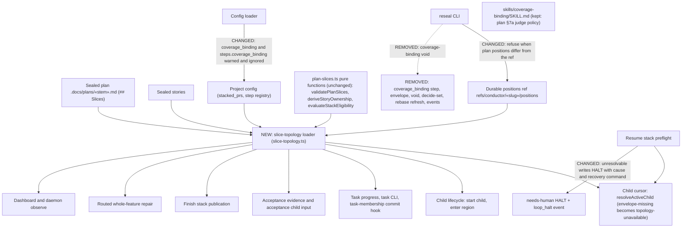
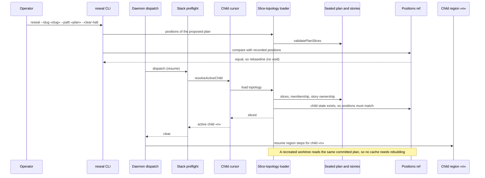
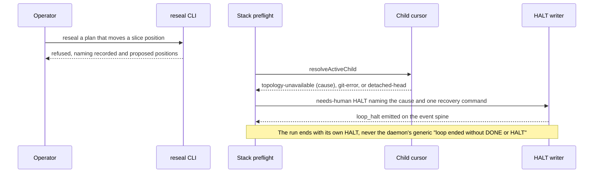

# Components and sequences: Stacked slice topology from the sealed plan

**Last updated:** 2026-10-23
**Scope:** To-be slice-topology source for stacked features after the `coverage_binding` step is
removed, for jstoup111/ai-conductor#3365 (folds #3366). Feature:
`multi-child-feature-cannot-resume-after-an-operato`. Covers the slice-topology loader, its readers,
the reseal position guard, the child cursor, and the resume preflight HALT. Flat (N=1) paths are
shown only to mark them unchanged.

## Component diagram

## Sequence: resume after a reseal or a worktree recreation

## Sequence: refused reseal and unresolvable cursor

## Legend

- **NEW**, **CHANGED**, and **REMOVED** mark what this feature adds, alters, or deletes. Other nodes keep today's behavior.
- «slug», «stem», and «n» are placeholders for the feature slug, plan stem, and child position.
- Flat (N=1) features have no child state and no positions ref. The cursor returns `no-child` and the loader's positions check never runs.

## Change Log

| Date | Change | Reason |
|------|--------|--------|
| 2026-10-23 | Initial generation | DECIDE for #3365 (folds #3366) |
