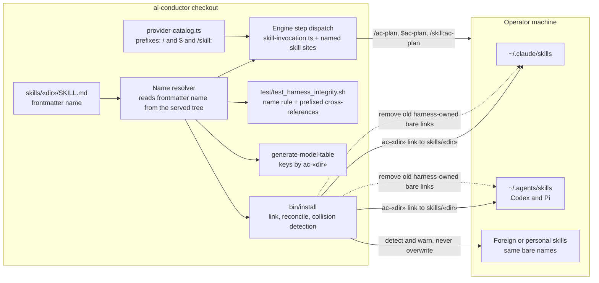

# Components: Namespaced harness skill names (`ac-` prefix)

**Last updated:** 2026-10-14
**Scope:** How a shipped skill directory becomes an installed, invokable name on Claude, Codex and Pi,
and how the engine and integrity suite resolve it. Spec 1 builds the frontmatter-driven resolver and
catalogs (names unchanged); Spec 2 flips every name to `ac-«dir»` and adds reconcile, collisions and
integrity enforcement. Intake #885; approach A (install-time `ac-` prefix,
no bare-name aliases).

## Diagram

## Legend

- **Solid arrows** are the canonical path: every consumer of a skill name reads it from the skill's
  frontmatter `name:` in the tree it serves (the feature worktree for self-host, the installed harness
  root otherwise). Spec 2 sets every `name:` to `ac-` + source directory name and the integrity suite
  enforces that rule.
- **Dashed arrows** are reconcile: prior harness-owned bare-name links (target under the prior harness
  root's `skills/`) are removed, freeing bare names for foreign skills and host built-ins. No aliases.
- **Foreign or personal skills** are never overwritten or removed; install reports the collision.
  Reconcile removes only links whose target is under the prior harness root's `skills/`.
- `«dir»` is the unchanged source directory name (e.g. `plan`); source directories are not renamed.
- `agents/*.md` persona files are omitted: they are read by path and never installed into a host
  namespace.

## Change Log

| Date | Change | Reason |
|------|--------|--------|
| 2026-10-14 | Initial generation | Composer DECIDE for #885 |
| 2026-10-14 | Frontmatter-driven resolver; two-spec delivery | Self-host builds run a `main` engine against the worktree skill tree, so names must be read, not computed |
| 2026-10-14 | Aliases dropped (approach A) | Symlink aliases cannot work: hosts take the name from frontmatter and Pi dedups same-file links; operator chose no aliases |
