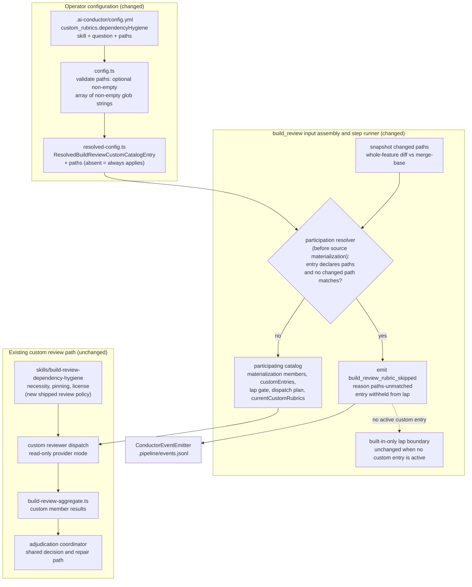
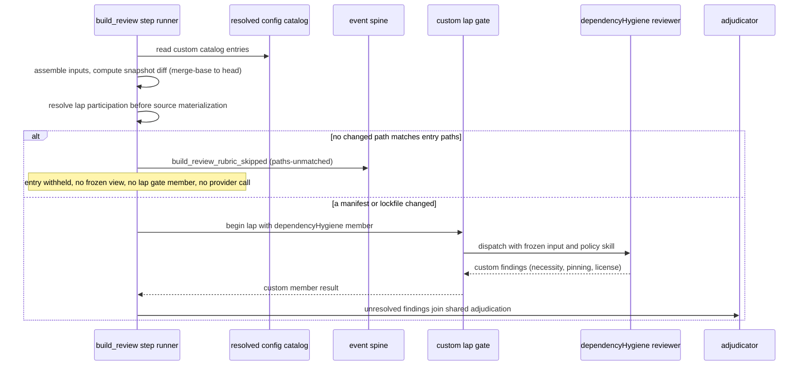

# Components: path-triggered custom build_review rubrics and the dependency-hygiene policy

**Last updated:** 2026-11-07
**Scope:** Proposed component boundaries for jstoup111/ai-conductor#2045. A `build_review.custom_rubrics`
declaration gains an optional `paths` glob list. Before any custom-lap machinery runs, the build_review
step runner matches each path-triggered custom catalog entry against the whole-feature changed-file set
(merge-base to head). An entry with no matching path is withheld from the lap: the engine emits the
existing `build_review_rubric_skipped` event with reason `paths-unmatched`, and the entry does not
appear in the lap gate members, the custom dispatch plan, or `currentCustomRubrics`. A shipped
`skills/build-review-dependency-hygiene` review-policy skill judges necessity, version pinning, and
license compatibility for dependency manifest and lockfile changes. This repository's
`.ai-conductor/config.yml` declares it with a manifest/lockfile `paths` set. Its findings use the
existing custom finding contract and pass through the existing adjudicator. No new module, event type,
artifact, or built-in rubric is added.

## Diagram

## Legend

- **Changed** boxes are edited by this feature; **unchanged** boxes are existing seams it relies on.
- `paths` is matched against the whole-feature changed-file set, not a per-lap delta, so a later lap
  keeps reviewing a dependency change that is still present and stops only when the feature diff no
  longer touches a matching path.
- An entry without `paths` behaves exactly as today. A withheld entry produces no artifact; the
  skip event is its only record, so no parallel channel is added.
- The policy skill is provider-neutral and runs under the existing Claude restricted and Codex
  read-only review modes. License is judged only from on-disk evidence and reported at a
  non-blocking severity when it cannot be determined.

## Change Log

| Date | Change | Reason |
|------|--------|--------|
| 2026-11-07 | Initial generation | Composer DECIDE for #2045 |
