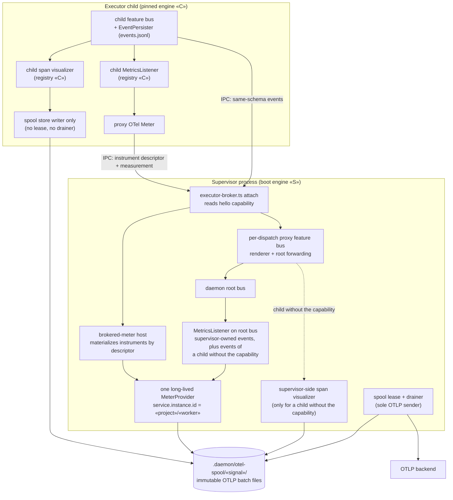
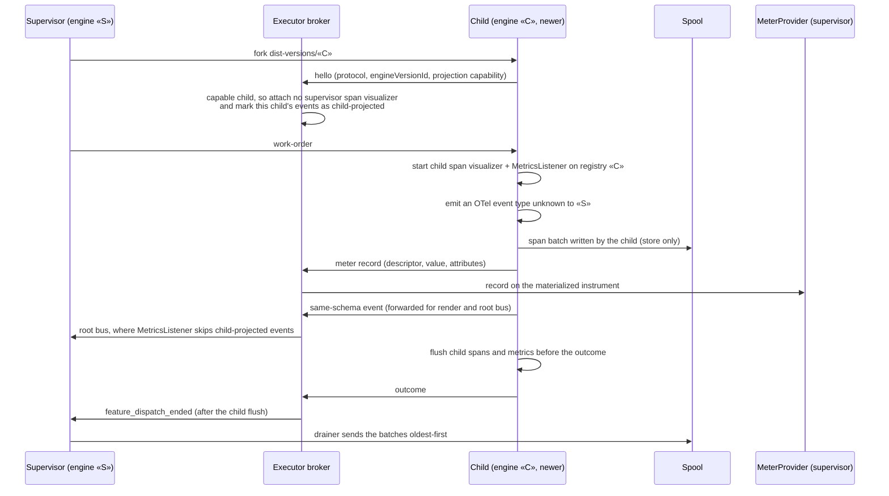

# Architecture: OTel projection runs in the version-matched child executor (#3646)

**Last updated:** 2026-11-07
**Scope:** Where a daemon dispatch's OTel spans and metrics are projected from its events. Today the
supervisor projects them using its own boot engine's event registry, so it drops every OTel event
type that a newer-pinned child declares but the supervisor does not know
(`executor-broker.ts` unknown-type filter). After this change, a child that advertises the
projection capability in its `hello` projects its own events with its pinned engine's code. Its
spans go into the shared `.daemon/otel-spool`. Its metrics record through a brokered OTel `Meter`
onto the supervisor's single long-lived `MeterProvider` (ADR-014 D7). A child without the
capability keeps today's supervisor-side projection. This builds on
[one daemon feature lifecycle in the child](daemon-still-carries-two-feature-executors-in-proc.md)
(#3333) and [per-dispatch engine pinning](engine-updates-reach-dispatched-features-only-afte.md).

## Components (L3), after this change

## Sequence: one dispatch on a newer pin

## Legend

- **«S» / «C»**: the supervisor's boot engine version and the child's WorkOrder-pinned engine version.
- **Projection capability**: an additive `hello` field. A child that predates it is projected by the supervisor exactly as today. Projection is never split for one dispatch: a single process projects it.
- **Brokered meter**: a coordination service in the sense of adr-2026-10-15 D4, against the dispatcher-owned `MeterProvider` (ADR-014 D7). It carries measurements, not occurrences. The events stay on the spine unchanged.
- **Spool**: multi-writer by design (ADR-014 D15). Only the lease holder drains (D16), and header values never enter the child.
- **Child-local types**: event types whose sink declaration in «C» has `otel: false`. Neither process projects them.

## Change Log

| Date | Change | Reason |
|------|--------|--------|
| 2026-11-07 | Initial generation | #3646: newer-engine child OTel events were dropped by an older supervisor |
| 2026-11-07 | Plan update: no structural change. The diagram's components map to the plan's new `engine/otel/brokered-meter.ts` (proxy meter and instrument host) and `engine/otel/child-otel.ts` (child projection), plus `createSpoolWriterRuntime` | /plan for #3646 |
