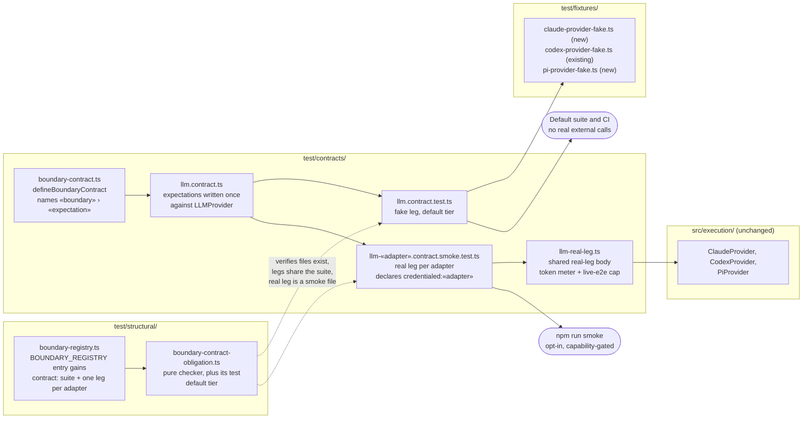
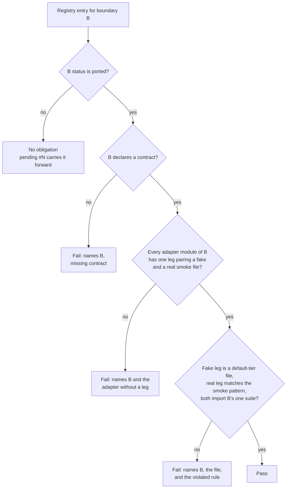
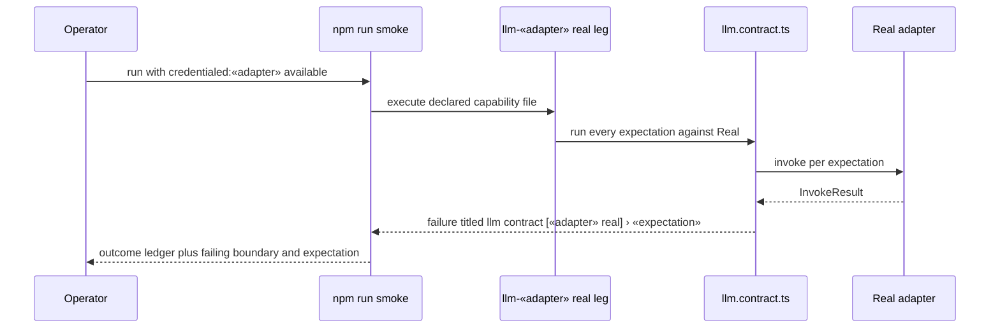

# Components: Paired fake-and-real boundary contracts (#1990)

**Last updated:** 2026-11-08
**Scope:** The paired-contract test mechanism for external boundaries in `src/conductor/test/`.
A contract is defined once and run in two legs:

- **Fake leg:** against the boundary's faithful fake, in the default Vitest tier.
- **Real leg:** against the real adapter, as an opt-in smoke file.

The boundary registry gains a contract obligation for every `ported` boundary. This spec ships the
`llm` contract for the Claude, Codex, and Pi adapters. The seven pending boundaries inherit the
obligation when their migrations (#3043, #3633–#3639) set them `ported`. Plan stem:
`nothing-proves-a-faithful-fake-still-matches-its-r`. There is no production (`src/`) change.

## Diagram

### Components

### Obligation verdict per registry entry

### Real-leg divergence report

## Legend

- **Fake leg:** runs in the default suite and CI, and never spawns a real provider.
- **Real leg:** a `*.smoke.test.ts` file. It runs only under `npm run smoke` when its declared
  capability is met, and otherwise it is skipped and recorded as skipped in the smoke ledger.
- Dashed arrows are structural checks that read files. Solid arrows are runtime calls.
- `«adapter»` is one of `claude`, `codex`, or `pi`.

## Change Log

| Date | Change | Reason |
|------|--------|--------|
| 2026-11-08 | Initial generation | Intake #1990 DECIDE |
