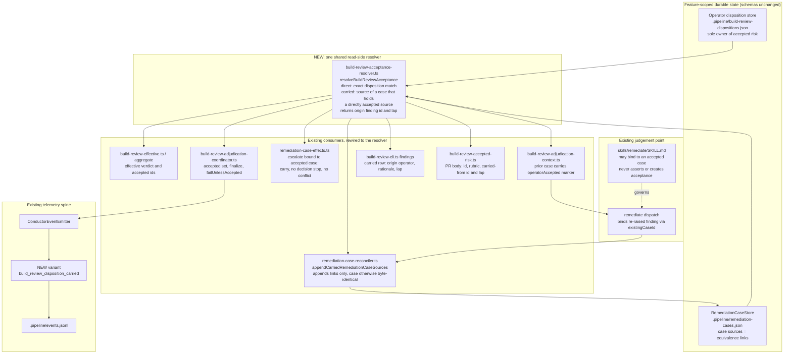
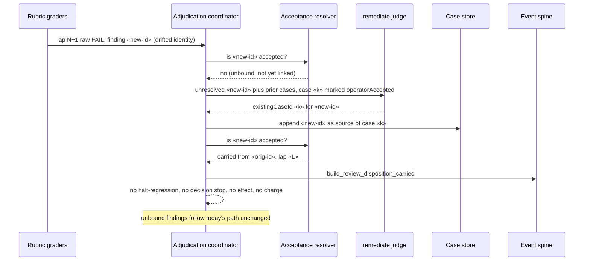

# Components: carried operator acceptance across build_review re-raises

**Last updated:** 2026-10-19
**Scope:** Proposed change for jstoup111/ai-conductor#3271. A read-side resolver derives carried
operator acceptance by joining the remediation case store's source links with the operator
disposition store. Every consumer of accepted risk reads that one resolver. The disposition store
stays the only writer and owner of accepted risk, and the case store stays the only owner of
equivalence links. Nothing new is persisted.

## Diagram

## Re-raise flow

## Legend

- **NEW** marks the only additions: one resolver function and one `ConductorEvent` variant with
  its sink registration. Every other node is an existing module changed in place.
- Solid arrows are data reads or writes; the dotted arrow is a governing contract.
- «placeholders» are variable identifiers.

## Change Log

| Date | Change | Reason |
|------|--------|--------|
| 2026-10-19 | Initial generation | DECIDE for jstoup111/ai-conductor#3271 |
| 2026-10-19 | Named the resolver module and the carried-link append | Plan-update for the #3271 plan |
